<h1 align="center">Cerdic 3D</h1>

<p align="center">
  <a href="https://cerdic.xyz">cerdic.xyz</a> · <a href="#quick-start">quick start</a> · <a href="#the-agent-loop">agent loop</a> · <a href="#gallery">gallery</a> · <a href="#the-language">language</a> · <a href="#architecture">architecture</a> · <a href="#docs">docs</a>
</p>

<p align="center">
  <sub>runs in the browser · Rust + WebAssembly · Bevy 0.20 renderer · MCP agent interface · zero imported models</sub>
</p>

---

<p align="center">
  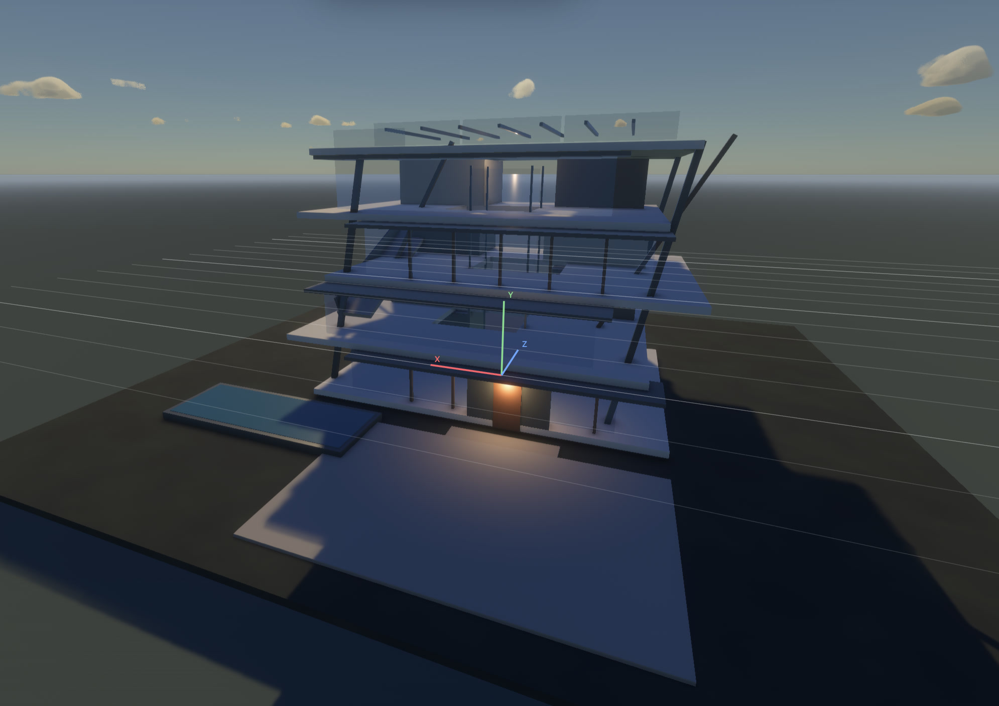
</p>
<p align="center"><sub>the shift house: four offset ring floors orbiting a planted central void, seen from the arrival side with the lit entry door and reflecting pool. a few hundred lines of text, no imported models, no texture files.</sub></p>

**an engine that a language model can drive, end to end.**

cerdic 3d builds 3d worlds from text, in the browser. a model (or you) writes a short scene file in a typed language; the engine evaluates it into real geometry, materials, light and motion; and a set of tools lets the model look at what it made, measure it, find what is wrong and fix it, without a human in the loop.

- **built for agents**: a model-facing tool surface (mcp) covers the whole loop: read the guide, write, evaluate, check, measure, look, edit one node, undo, export. every tool is typed, bounded and returns errors that say how to fix them. [the agent loop →](#the-agent-loop)
- **text in, world out**: one line per object. a castle, a street or a character is a text file you can read, diff, review and ask a model to change. no meshes, no texture files, no asset store.
- **the same commands for people and models**: whatever the model can do, the editor can do, and every edit is undoable and checkable.
- **real modeling, not toy shapes**: solid booleans, subdivision surfaces, bevel, inset, extrude, loft, skin, uv unwrap, decimation and lod, with much of the work done by by rust and compiled down to webassembly.
- **procedural materials that read the surface**: 398 texture nodes compiled to shaders and baked in the browser. weathering follows cavities, edges and up-facing surfaces instead of being painted on.
- **living worlds**: terrain with erosion, rivers, trees and rocks by rule, physically based sky and atmosphere, water, particles and fire, animation tracks and state machines, rigs, walking characters, navigation and game rules.
- **deterministic**: the same text gives the same geometry on a laptop, in a worker and in the native test build. a parity suite checks it bit for bit, so a model's result is reproducible.
- **one tab, no server**: the toolchain runs as webassembly. a server is never required.

---

## a live sidebar session

<p align="center">
  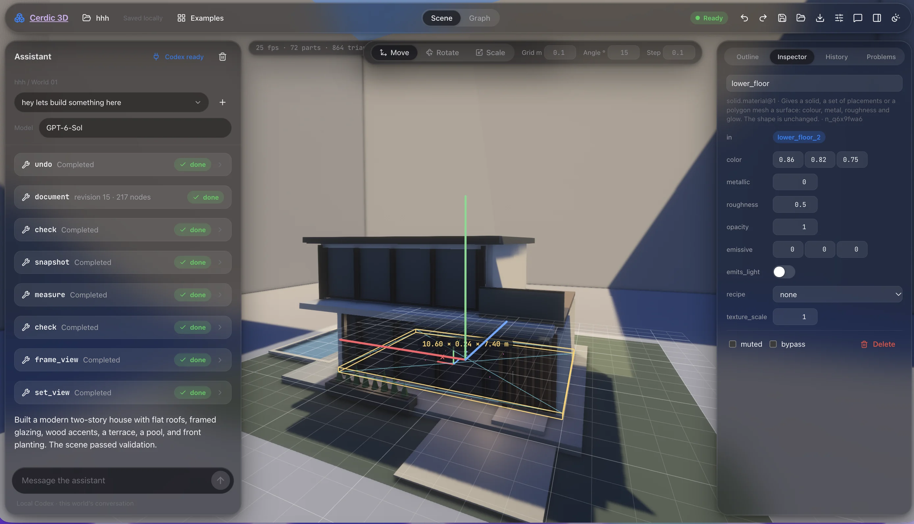
</p>
<p align="center"><sub>a real sidebar session: a generated house, tool activity, measurements, and an editable scene in the same workspace.</sub></p>

The sidebar connects to the Codex account signed in on your computer. Choose a model, describe a world, then refine it in the same conversation. The agent uses the engine's tools to build, check, measure and inspect its result; you can edit the same geometry through the inspector or graph. Project/world conversations keep separate agent threads.

---

## the agent loop

most "ai makes 3d" tools ask a model to produce a finished mesh in one shot, or call a service that returns a model. that is hard to inspect, hard to fix and impossible to reproduce. cerdic 3d takes the opposite approach: **the model never draws a mesh.** it writes small, typed steps and uses tools to check them, the way a programmer uses a compiler, a debugger and a profiler.

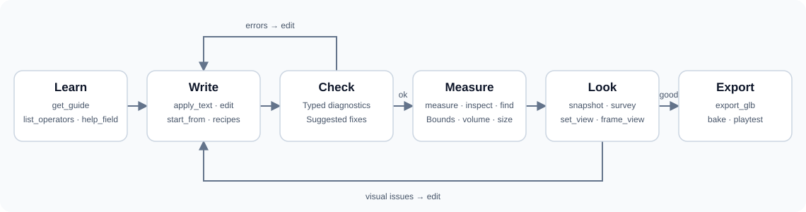

**what each stage gives the model**

| stage | tools | why it works for an agent |
| --- | --- | --- |
| learn | `get_guide`, `list_operators`, `help_field`, `texture_nodes`, `recipes` | the guide is generated from the same registry that validates input, so it cannot drift from the engine. the model asks for only the topics and operators it needs, so the prompt stays short and cacheable. |
| write | `apply_text`, `apply_commands`, `edit`, `batch`, `run`, `script`, `start_from` | line-per-node text is the format models are most reliable at. `edit` changes one node by label, so a fix is a small diff, not a regeneration. `batch` and `run` keep intermediate output out of the context. |
| check | `check`, `diff`, `undo`, `redo` | failures are typed: the line, what was wrong, and how to fix it. a bad parameter is rejected with its valid range instead of producing broken geometry. |
| measure | `measure`, `inspect`, `find`, `scene_overview`, `survey` | numbers a model can reason about: bounding boxes, volume, triangle counts, distances, collisions. "is the roof above the walls" becomes a query, not a guess. |
| look | `snapshot`, `survey`, `set_view`, `frame_view` | the model sees what it built, from cameras it chooses, and can compare against the previous capture. |
| ship | `export_glb`, `bake`, `playtest`, `game_describe`, `make_character` | exports a `.glb` and plays a generated game to see whether it works. |

**design rules that make a language easy for a model to use**

- **names, not indices.** parts and regions have names ("the cap", "the ring", "the flukes"), and operators carry provenance, so a model selects by meaning instead of by vertex number.
- **flat, typed, bounded parameters.** every setting has a unit, a range, a default and often an enum. the guide, the tool schema and the editor's inspector all come from one registry.
- **intent-level nodes over raw ones.** high-level operators (round the hard edges, inset a panel, scatter on a surface) sit on top of the low-level ones, which stay available for people and for advanced cases.
- **cheap to check, cheap to retry.** estimate before running, caps and cancellation on heavy operators, undo for everything.
- **a typed document, not arbitrary code.** the model emits a document the engine validates. a script node exists for builders that need real logic; it is permissioned and its size is capped.
- **deterministic output.** a fix that works once works every time, which is what makes an automated loop converge.

**evidence so far.** with an mcp-connected model, real runs built a raised panel, a house, a cottage, a stool and an lod sphere; 6 of 6 textured objects; 4 of 4 animated ones; and 3 of 3 interactive behaviours (a clickable door, an automatic sliding door and a lever). the prompt harness is in `engine/tools/mcp/eval-prompts.mjs`. the larger evaluation, a 60-task comparison of typed nodes against generated code, is still to be run and we do not claim its result.

**a session, condensed and illustrative** (the shape of the loop, not a recorded transcript)

```text
model  → get_guide(topics=[core, materials], operators=[solid.*, xform.*])
model  → apply_text("table_b = solid.box@1(size=[9, 0.3, 6]) ...")
engine → error at line 14: roughness must be in [0, 1], got 4. try roughness=0.5
model  → edit(label="table_m", roughness=0.5)
model  → measure()          # bbox, volume, triangles: the top is 0.3 m thick, as intended
model  → snapshot(views=[front, iso])
model  → export_glb()
```

connect any mcp client to `engine/tools/mcp/server.mjs`, open the editor with `?mcp=1`, and the same loop is available to your own agent.

---

## gallery

every image below is a screenshot from the live viewer at 2560 px: real lighting, shadows, sky, materials and haze. the numbers are explained under each picture.

### a modern house

a cantilevered house with floor-to-ceiling glass, a pool and deck, a roof terrace and a furnished interior. written from scratch, not assembled from stock parts.

<p align="center">
  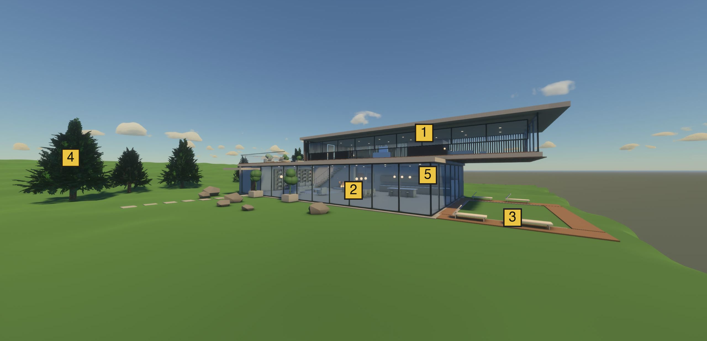
</p>

> **1** cantilevered upper floor · **2** floor-to-ceiling glazing · **3** pool and deck · **4** pines planted over the terrain by rule · **5** fireplace flame (a live effect)

<p align="center">
  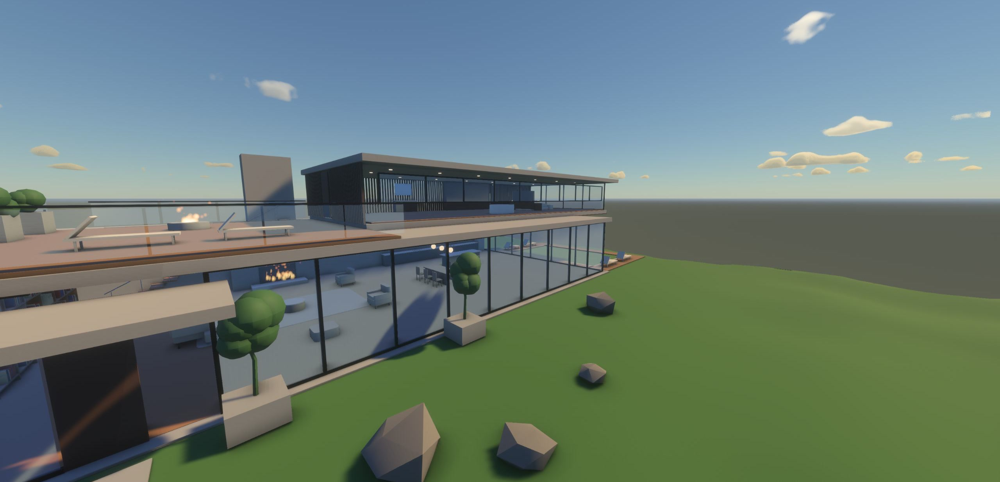
</p>
<p align="center"><sub>the roof terrace: loungers, a fire bowl, glass balustrade and the living space below.</sub></p>

### paris

four limestone apartment buildings face each other across a tree-lined boulevard: rusticated ground floors with shopfronts and awnings, tall french windows with wrought-iron balconies, string courses, a cornice, zinc mansard roofs with dormers and brick chimneys, streetlamps, and the eiffel tower closing the view.

<p align="center">
  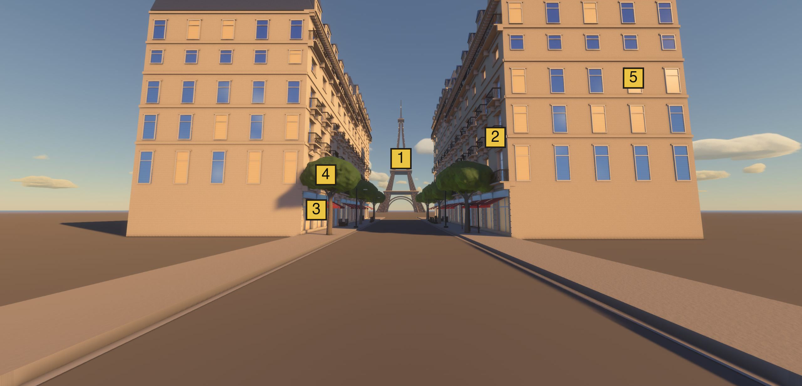
</p>

> **1** the eiffel tower, about 28,000 triangles of ironwork · **2** wrought-iron balconies · **3** shopfronts with awnings · **4** street trees, planted by rule · **5** windows lit with emissive materials

<p align="center">
  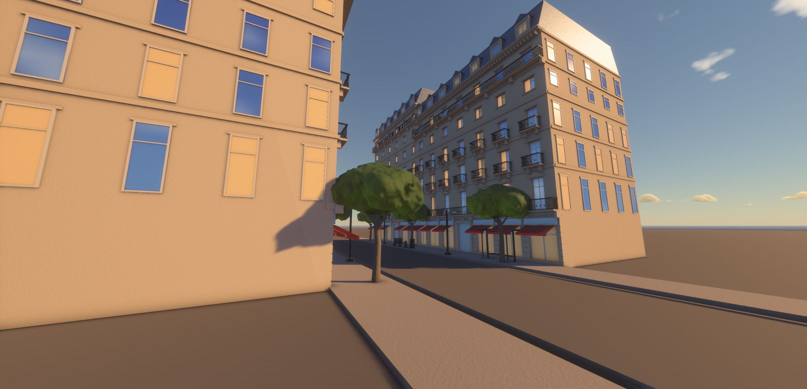
</p>
<p align="center"><sub>facade detail: balconies, dormers, a modillion cornice and shopfront awnings.</sub></p>

<p align="center">
  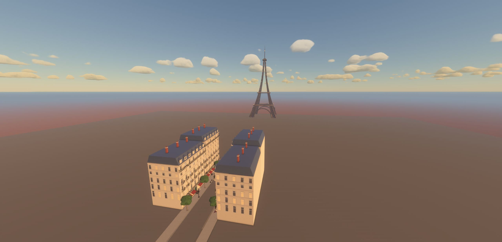
</p>

### a japanese mountain village at dusk

a paved street between two rows of machiya townhouses (timber frame, plaster, lattice, indigo noren, tiled roofs), a thatched farmhouse, a koi pond with an arched bridge, then stone stairs under three torii up the hillside to a shrine terrace with a main hall and a five-tier pagoda. pines, cherry blossom and maples are planted over the terrain by rule; lanterns, paper windows and a few real lights make the dusk. the buildings come from one grammar (a facade width, depth and floor count).

<p align="center">
  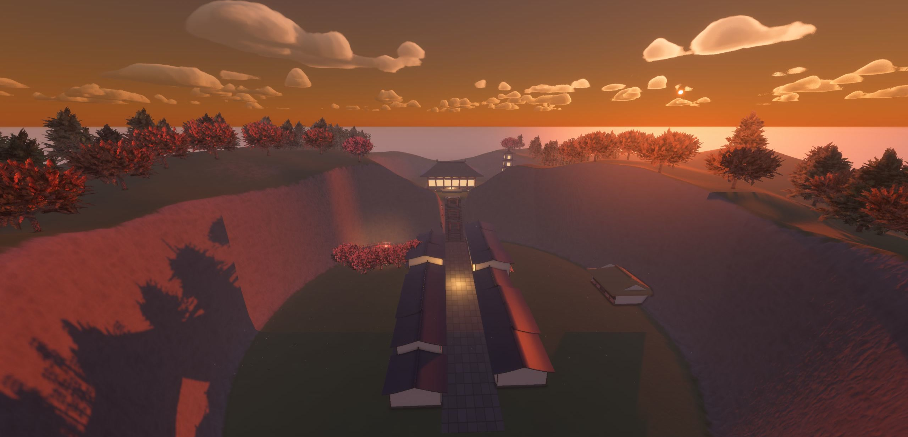
</p>

<p align="center">
  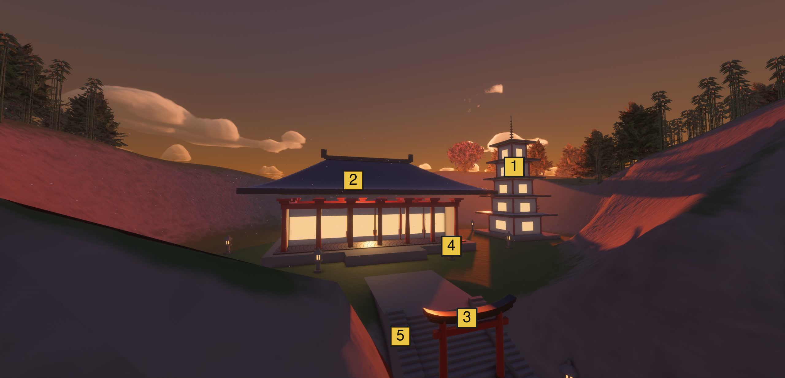
</p>

> **1** five-tier pagoda · **2** main hall, timber frame with glowing paper walls · **3** torii gate · **4** stone lantern · **5** stairs climbing the hillside

<p align="center">
  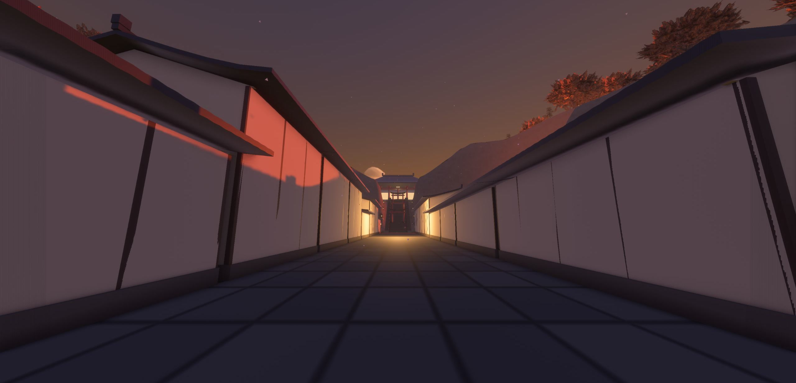
</p>
<p align="center"><sub>the village street at dusk, looking up toward the torii and the shrine.</sub></p>

### a farm tractor

a 150 hp row-crop tractor built to real figures: 5.3 m overall, a 2.80 m wheelbase, rear tyres 1.96 m high and 0.65 m wide, front tyres 1.30 m. a four-post cab with glass all round, a hood lofted from cross-sections, a cast-iron chassis (transmission, final drives, axles and engine block) made as smooth-united fields, a three-point hitch with lift rods and a top link, a PTO stub, a front weight, steps, handrails, mirrors, work lamps, a beacon and an exhaust stack. the paint is a shape-aware texture program: dust settles on top surfaces, mud gathers low down and edges wear through.

<p align="center">
  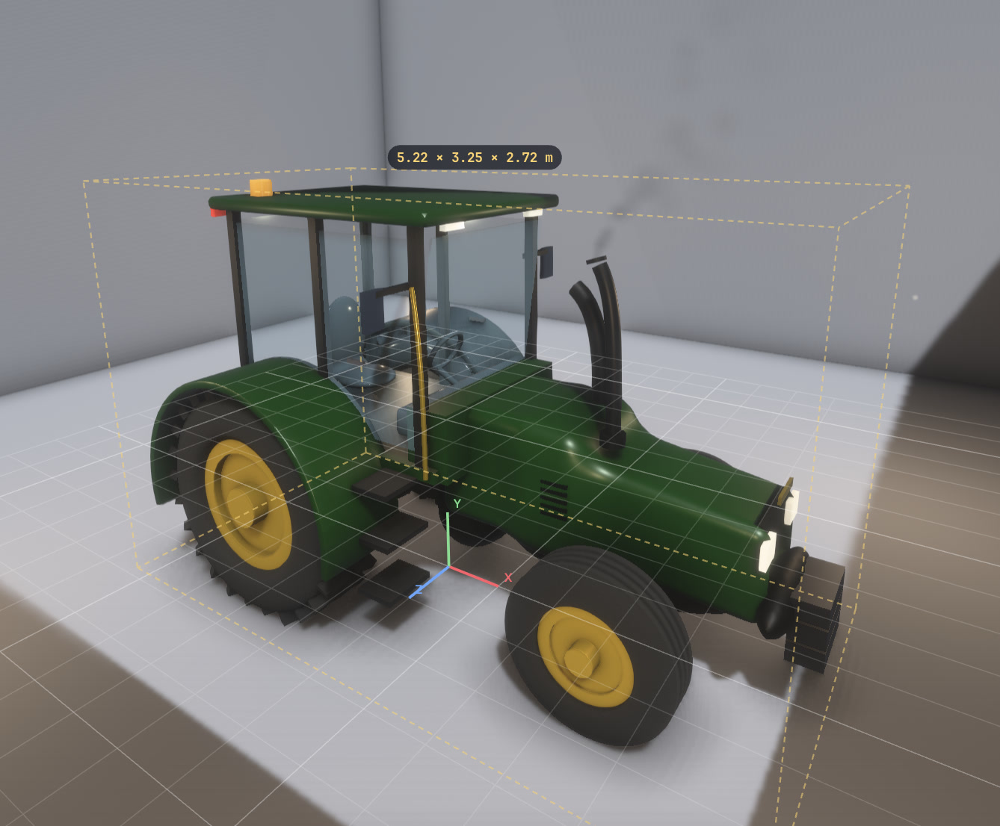
</p>
<p align="center"><sub>the tractor in the live viewer, selected: the box and the label (5.22 × 3.25 × 2.72 m) are the editor's own measurement overlay, and the axes show the part's frame. an audit script measures the evaluated mesh against the real figures and names the value to change.</sub></p>

### animation, lighting and materials

<p align="center">
  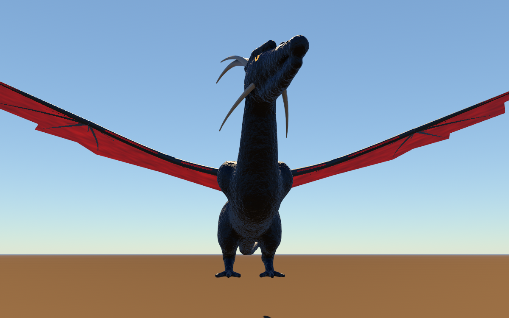
  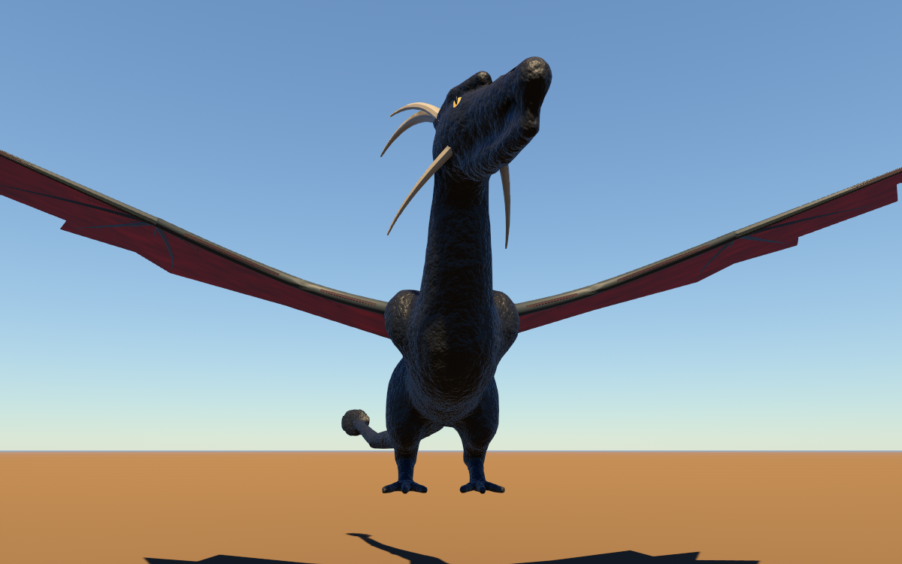
</p>
<p align="center"><sub>the wing membrane is translucent, so the same wing reads differently when it is lit from the front and from behind.</sub></p>

<p align="center">
  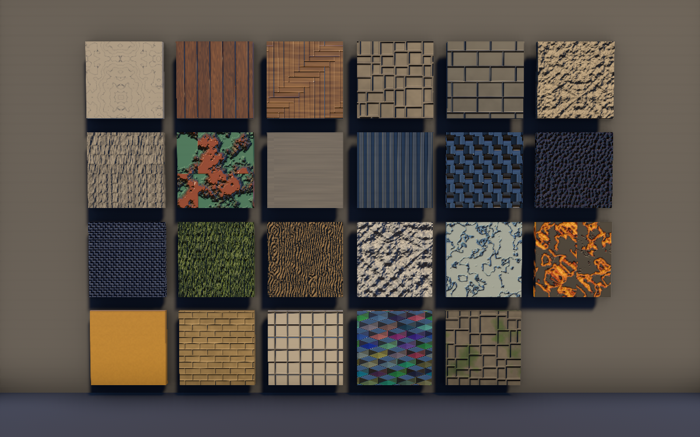
</p>
<p align="center"><sub>procedural materials in the live viewer. no image files.</sub></p>

<p align="center">
  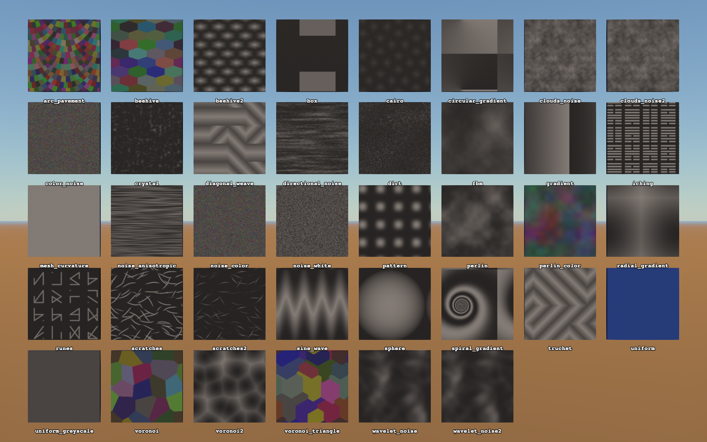
</p>
<p align="center"><sub>part of the texture node catalogue: voronoi, cairo, beehive, truchet, perlin, wavelet noise and more.</sub></p>

---

## animation

<p align="center">
  <a href="docs/media/anim/globe.mp4"></a>
  <a href="docs/media/anim/dragon.mp4">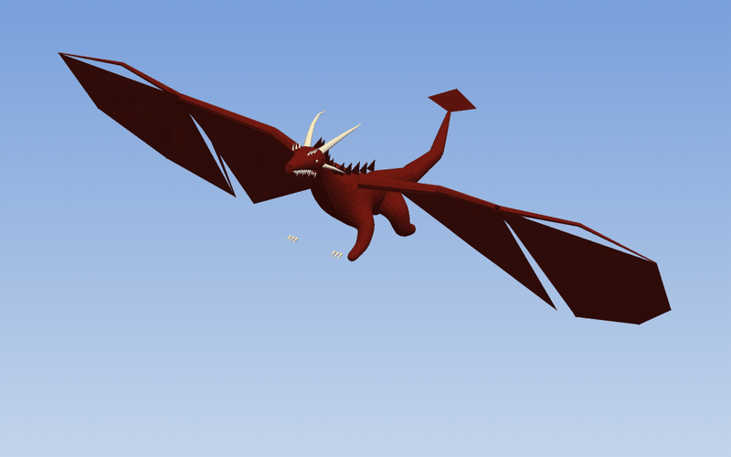</a>
</p>
<p align="center"><sub>a snow globe (a 14-second lift-and-shake track, a circling skater and a toy train on a ring of track; the glass is hidden here so the village shows) and a dragon (membrane wings, jaw and tail). click for the full-quality video. these clips are posed from each model's own <code>anim.track</code> data by the engine's geometry viewer, at 12 and 14 frames per second.</sub></p>

<p align="center">
  <a href="docs/media/anim/tractor.mp4">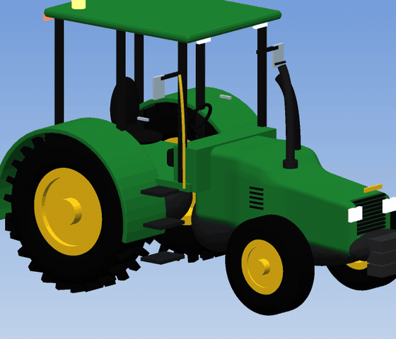</a>
</p>
<p align="center"><sub>an earlier, simpler tractor from the same toolbox (rendered offline): its wheels (rear and front at different speeds), steering wheel and beacon are each driven by their own <code>anim.track</code>, and the camera swings gently around it.</sub></p>

a part moves because an `anim.track` line says so: keys of position, rotation or scale over time, about a pivot you choose. a child follows its parent through `anim.parent`, so an outer wing rides on the inner wing, which rides on the shoulder. tracks can also toggle visibility (a dragon's fire) and repeat (a snow globe that lifts, shakes and sets down every 14 seconds). on top of tracks sit:

- **state machines** (idle, walk, run, blended by speed) and **layered overlays** (a wave over a walk), in `ve-animstate`;
- **procedural foot placement** for bodies with any number of legs, in `ve-gait`;
- **secondary motion** with pinned verlet chains for banners, tails and hair, in `ve-chain`;
- **reactions**: `behavior.on` runs a clip when a part is clicked or approached, in fixed 1/60 s steps so the same trigger gives the same pose everywhere.

all of it is deterministic: the same clock gives the same pose on every machine. a model can author tracks through the same typed commands, and the viewer plays them and the exporter writes them into the `.glb`.

---

## the language

a world is a text file. each line makes one thing: `name = operator@version(inputs, settings)`. later lines use earlier names. there are constants, loops and macros for repetition, and a small script node for builders that need real logic.

```
sky   = scene.sky@1(sun_elevation=38, sun_azimuth=-55, sun_intensity=3.4, turbidity=2.4, clouds=true)
env   = scene.environment@1(sky_color=[0.62, 0.74, 0.92], intensity=1.0, reflection=0.6)
sea   = water.surface@1(size=[500, 500], wave_height=0.7, wave_length=24, speed=0.8)

table_b = solid.box@1(size=[9, 0.3, 6])
table_a = xform.move@1(table_b, by=[0, -0.15, 0])
table_m = solid.material@1(table_a, color=[0.72, 0.4, 0.24], metallic=0.0, roughness=0.5)

output sky = sky
output env = env
output table = table_m
```

the studio shows the same document as a graph. this is the shift house from the top of this page: 80 nodes, each one a line of the text.

<p align="center">
  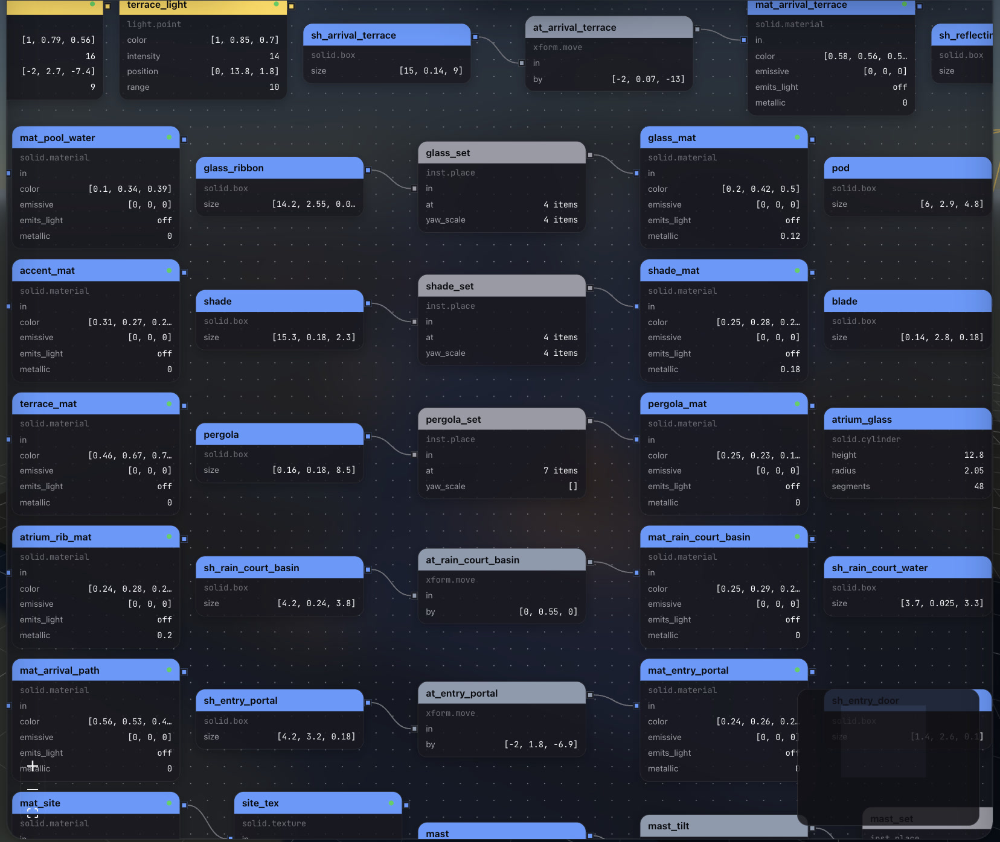
</p>
<p align="center"><sub>the shift house in the graph view. blue headers are the modeling nodes (<code>solid.box</code>, <code>solid.cylinder</code>, <code>solid.material</code>), grey ones place and move them (<code>xform.move</code>, <code>inst.place</code>), and yellow ones are lights (<code>light.point</code>). each box lists its settings, and the lines between them are the same references the text uses.</sub></p>

edit a value in the graph or in the text and the other follows, and a model can do the same through the typed commands.

procedural materials use the same style, compiled to a shader and baked in the browser:

```
n      = fbm(scale_x=6)
albedo = colorize(n, gradient=[0:#3b2210, 1:#c98a4b])
```

`surface_*` nodes (ambient occlusion, cavity, convexity, up-facing, height) let a material know the shape it sits on, so rust gathers in crevices and paint wears at edges.

---

## architecture

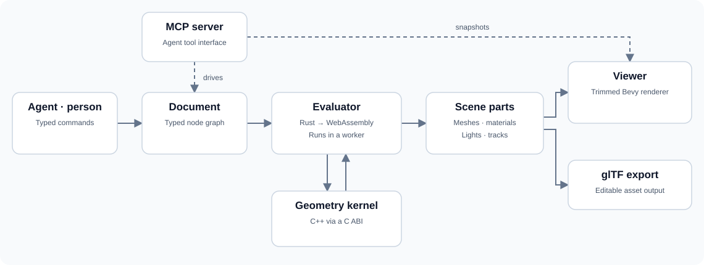

- **rust owns the rules.** the document, commands, stable ids, history, validation, physics, navigation, game rules and animation live in crates with no engine or platform dependencies, so they are tested natively and run the same in the browser. no `unwrap`, `expect` or `panic!` in library code; lints are workspace-wide and not silenced.
- **c++ owns the heavy geometry.** solid booleans (Manifold), subdivision surfaces (OpenSubdiv), mesh simplification (meshoptimizer), 2d offsetting (Clipper2), tangents (MikkTSpace), and bevel, inset, extrude, solidify, poke, wireframe, dissolve, symmetrize, decimate, unsubdivide, uv unwrap written in rust. behind a plain C ABI with no exceptions across it.
- **a trimmed bevy fork draws it.** physically based shading, sky and atmosphere, shadows, water, terrain, grass and tree wind, depth of field, haze, motion blur and baked light probes.
- **the editor is a react and typescript app.** it hosts the canvas and panels (outliner, inspector, history, problems). rust stays the source of truth.
- **deterministic by construction.** the maths avoids platform-dependent functions (trigonometry is replaced by deterministic versions), compiles without fused multiply-add, and a parity corpus runs the same documents natively and in webassembly and compares the bits. measured: a bevel of a 540k-face mesh takes about 230 ms natively and 480 ms in webassembly, with identical output.
- **mcp is the agent boundary.** the server speaks to the open editor page, so a model sees exactly what a person sees.

### what is in the box

| area | what it does | crates |
| --- | --- | --- |
| core | names, registry, typed commands, history | `ve-core`, `ve-graph`, `ve-evaluator` |
| geometry | solids, polygon meshes, curves, fields, subdivision, lod | `ve-kernel`, `ve-kernel-sys`, `ve-geometry`, `ve-modeling` |
| worlds | terrain tiles, erosion, rivers, rocks, flora, scatter, sky | `ve-world`, `ve-sky` |
| rendering | the viewer, shaders, baked light probes | `ve-bevy`, `ve-render`, `ve-gi`, `ve-runtime` |
| characters | a human body from open data, rigs, gait, secondary motion | `ve-human`, `ve-gait`, `ve-chain`, `ve-animstate` |
| life | npc behaviour, navigation, game rules, interaction | `ve-npc`, `ve-nav`, `ve-game`, `ve-interact` |
| effects | particles and fire, procedural audio, physics | `ve-particles`, `ve-audio`, `ve-physics` |
| tooling | measuring and collision checks, the model/provider boundary, browser platform | `ve-measure`, `ve-provider`, `ve-platform-web` |

### exporting

the document panel and the mcp `export_glb` tool write `.glb` with welded meshes, crease-angle normals, pbr materials, baked textures, instancing and animation, validated against the khronos glTF validator.

---

## quick start

you need bun 1.3+, the rust toolchain pinned in `engine/rust-toolchain.toml`, cmake, ninja and a wasi-sdk (set `WASI_SDK`; the default is `~/.local/share/toolchains/wasi-sdk-34.0-arm64-macos`).

```sh
bun install --frozen-lockfile
bun run dev
```

open **http://127.0.0.1:5173**. the first run builds the webassembly modules.

open one of the example worlds directly, with the mcp bridge on:

```
http://127.0.0.1:5173/?world=worlds/paris.txt&scene=open&mcp=1
```

swap `paris` for `modern`, `japan_village`, `harbour`, `castle`, `snowglobe` or `chinese`. the worlds live in `engine/web/tests/scenes/` as plain text: copy one and change it.

| key | does                                        |
| --- | ------------------------------------------- |
| `F` | frame the selection, or the scene's subject |
| `R` | return to the home view of the scene        |

### connecting your own agent

1. start the editor and open a world with `&mcp=1`.
2. point an mcp client at `engine/tools/mcp/server.mjs`.
3. ask it to call `get_guide` first, then build, `check`, `measure` and `snapshot`.

### checking geometry without a browser

```sh
cd engine
./target/release/examples/dump_obj web/tests/scenes/modern/modern.txt /tmp/house_obj
bun tools/render-obj.ts /tmp/house_obj /tmp/house.png --az 35 --el 22 --size 2400 --ssaa 2 --wire
bun tools/scene-look.ts web/tests/scenes/modern/modern.txt /tmp/look   # contact sheet in seconds
```

`--ssaa` smooths edges, `--wire` draws the triangles, `--only` and `--skip` pick parts by name, and `--labels file.json` writes where each part lands on the picture. this is a fast geometry check, not the lit viewer.

---

## development

```sh
bun run engine:build:dev   # rebuild both engine modules
bun run typecheck          # schema drift check, then TypeScript
bun run build              # release build of the app

cd engine
cargo check --workspace
cargo test --workspace
cargo xtask quick          # tests for the crates you changed
cargo xtask check --strict # native, wasm, C++, parity and browser gates (slow)
```

strict validation needs cargo-nextest, cargo-deny, clang-format, clang-tidy and playwright chromium (`cd engine/web && bun install --frozen-lockfile && bun x playwright install chromium`).

### layout

```
engine/
  crates/      the rust workspace (29 crates)
  cpp/         our C++ kernel layer behind a C ABI
  lib/         vendored sources: bevy (trimmed), manifold, clipper2, opensubdiv,
               meshoptimizer, eigen, fmt, mikktspace, material-maker, wgpu-hal
  web/         the viewer page, demos, browser tests and the example scenes
  tools/       the mcp server, renderers, audits, world generators
src/           the React + TypeScript editor
```

## docs

[Architecture overview](docs/architecture.md) · [Projects and assistant setup](docs/project-workspace.md)

## a note on assets

cerdic 3d does not import models, textures or sounds. the one dataset it reads is an open (CC0) human body pack, with its clothes and hair, used as the base for characters; everything else is generated from text.

## sidebar assistant (local Codex)

With Codex installed and signed in (`codex login`), run the web app and the local API server (`bun server/index.ts` if Vite is already running). Open a project, choose **Connect assistant → Connect local Codex**, select a model, then **Start chatting**. Prompts in the sidebar can now inspect, build and edit the current world through its engine tools; replies and tool activity stream back into the conversation. Use **Stop** to interrupt work. No extra API key is required for this local integration.

Project/world conversations keep separate agent threads. See [projects and assistant setup](docs/project-workspace.md) for persistence, external MCP, and the opt-in live verification command.
