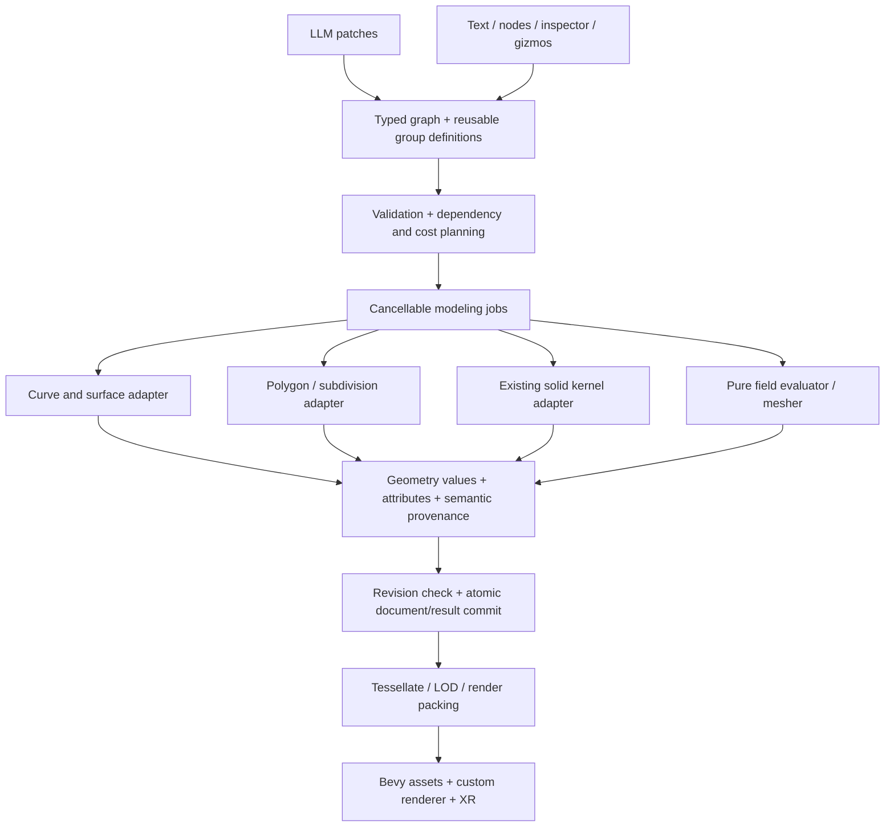

# Spatial Lab: advanced modeling and extensible geometry-node system

**Research date:** 2026-10-12, continuing research begun 2026-10-11.

**User objective:** create advanced models across many categories, using a much richer procedural toolset that AI and humans can compose and edit. Investigate existing implementations that can be reused or ported instead of limiting generation to basic primitives.

**Status:** research and proposed implementation plan. No libraries were installed, vendored, compiled or integrated for this document. Browser/WASM compatibility below distinguishes upstream evidence from untested integration proposals. Existing engine changes belong to another agent and were left untouched. The checkout was at `b0c2b75` during the final local inspection and remains under active development.

This supplements the [earlier code audit and language handoff](research-handoff.md). That report covers reproduced bugs, transactions, XR and safety foundations; this report focuses on expanding actual modeling capability. Language/modeling expansion needs its own follow-on track rather than silently replacing the ongoing runtime milestones.

## 1. Recommendation

**Build a modular procedural modeling system with multiple geometry representations, reusable node groups, and adapters around existing geometry libraries.** Keep Bevy as the runtime/rendering integration. Make the authored graph independent of Bevy and independent of any one geometry backend.

The first expansion stack worth testing is:

| Layer | Recommended direction |
|---|---|
| Solid booleans and closed procedural volumes | Extend the existing Manifold integration. |
| Curves, lofts, sweeps and smooth parametric surfaces | Evaluate Curvo as the first Rust adapter. |
| Polygon topology, remeshing and surface processing | Evaluate the core PMP library; compare Geometry Central only where its algorithms are needed. |
| High-quality subdivision surfaces | Evaluate OpenSubdiv's CPU components after resolving its exact license/build configuration. |
| Profiles and planar operations | Reuse existing Clipper2; consider Cavalier Contours for arc-preserving operations and Lyon for path tessellation. |
| Organic fields and meshing | A bounded pure expression/field graph, initially through the available kernel's meshing capability; evaluate more advanced sparse/adaptive methods separately. |
| UVs and optimized display meshes | xatlas plus existing meshoptimizer, with seam/provenance handling. |
| Reuse and complexity | Parameterized graph groups, shared instances, semantic selections, incremental evaluation and cancellable workers. |

These are **porting candidates**, not a statement that they already compile together or that every upstream dependency meets the repository policy. Choose one backend per responsibility initially. Avoid collecting several overlapping mesh kernels without a demonstrated need.

A large node catalog is feasible. Its usefulness depends on the geometric algorithms underneath it, a rich geometry data model, and reliable composition. A single `bevel` label does not supply edge-intersection handling, a `character` label does not supply anatomy or deformation topology, and a watertight mesh does not establish visual quality.

## 2. How Blender modeling works, and what Bevy contributes

### 2.1 Blender combines several modeling systems

Blender's editable polygon system exposes connectivity and editing operations through BMesh. Its elements include vertices, edges, faces and loops; the internal design supports adjacency traversal rather than treating a model as just triangles for a GPU. The Python module exposes operations such as splitting, dissolving and collapsing. [BMesh API](https://docs.blender.org/api/main/bmesh.html), [BMesh design](https://developer.blender.org/docs/features/objects/mesh/bmesh/).

A useful conceptual model for Spatial Lab is:

```text
Authored geometry and parameters
    → ordered modeling operations / procedural graph
    → evaluated geometry with attributes and provenance
    → tessellated display mesh
    → materials, deformation and rendering
```

Geometry Nodes supplies a dataflow authoring system, including reusable groups, geometry values, instances and per-element fields. A field can evaluate differently depending on the geometry and attribute domain at its consumer. Capturing an attribute freezes an evaluated result for later use. [Blender fields](https://docs.blender.org/manual/en/latest/modeling/geometry_nodes/fields.html), [node groups](https://docs.blender.org/manual/en/5.3/interface/controls/nodes/groups.html).

Subdivision is a separate capability with topology and interpolation rules. OpenSubdiv is a reusable library specifically designed for integration into content tools; it supplies subdivision evaluation, not a complete modeling application. [OpenSubdiv introduction](https://opensubdiv.org/docs/intro.html).

**Design implication:** Spatial Lab can adopt this separation while implementing its own authoring system. It needs connectivity-aware surface data, operations, fields, attributes and display conversion—not a direct copy of Blender's entire application architecture.

### 2.2 Bevy is the runtime integration point

Bevy's `Mesh` stores renderable vertices/indices and attributes and can be generated or changed programmatically. That makes it a suitable consumer of modeling results. It does not by itself provide the complete editable topology, NURBS, robust bevel, sculpting and node-authoring stack described here. [Bevy Mesh API](https://docs.rs/bevy/latest/bevy/prelude/struct.Mesh.html). Check the vendored version for exact APIs; upstream `latest` documentation can differ.

For this repository, the custom renderer also needs explicit support for new attributes, material bindings and eventually skinning. Adding a Bevy component does not automatically enable a feature in the project's custom shader pipeline.

Recommended responsibilities:

- **Modeling core:** typed document, operator registry, geometry representations, parameters and evaluation.
- **Bevy/ECS:** runtime entities, transforms, visibility, interaction, asset residency and render updates.
- **React:** authoring panels, node/text views, inspection and command submission.
- **Worker:** expensive geometry evaluation and intermediate caches.
- **Server:** provider calls and normalized bounded graph proposals; API keys stay here.

### 2.3 Can we port Blender itself?

There are three distinct approaches:

| Approach | Evaluation |
|---|---|
| Compile/copy Blender's modeling source into this engine | Conflicts with the current permissive-only ADR. Blender is GPL. Porting language or wrapping a function does not resolve that project-policy conflict. [Blender license documentation](https://developer.blender.org/docs/license/). |
| Run Blender separately for controlled offline tasks | The existing ADR explicitly allows a separate offline worker for baking, UVs or renders. This adds an execution/deployment model and should remain optional. It does not automatically satisfy the browser-only interactive requirement. |
| Integrate independently distributed geometry libraries and implement the missing glue | Recommended browser path. Upstream libraries can provide much of the difficult math while Spatial Lab owns graph semantics, identity, validation and interaction. |

The BMesh API's description of a standalone module is not proof of a ready-made permissively licensed browser package. Do not plan around `pip install bpy` becoming a small WASM plugin.

Use algorithm papers and public documentation as design references. Keep provenance and license information for any source actually copied. This report identifies project-policy constraints; it is not a legal determination about a future distribution.

## 3. What established procedural systems teach us

| System / evidence | Relevant lesson | Proposed application |
|---|---|---|
| Blender fields, groups and instances | Computation, geometry and reusable graph interfaces are distinct. | Typed field values; group ports; shared prototypes; explicit realization. |
| Houdini geometry attributes | Data belongs to domains such as points, vertices/corners, primitives and whole objects. [Attributes](https://www.sidefx.com/docs/houdini/model/attributes.html). | Domain-aware normals, UVs, masks, IDs and material data. |
| Houdini compiled blocks | Restricting dependencies enables efficient grouped execution and reduces unnecessary device transfers. [Compiled blocks](https://www.sidefx.com/docs/houdini/model/compile.html). | Explicit dependencies and effects; batch/fuse compatible operations after profiling. |
| OpenSubdiv | Surface evaluation can separate topology from changing values and interpolation rules. [Far overview](https://www.opensubdiv.org/docs/far_overview.html). | Cache subdivision topology/stencils when only positions change. |
| Infinigen | Broad procedural content is demonstrated through substantial object/material generator libraries. [Project](https://infinigen.cs.princeton.edu/). | Build our own reusable procedural groups after the generic operators work. This is evidence of feasibility, not a browser performance guarantee or permission to import its assets. |
| BlenderAlchemy | Iterative visual feedback has been studied for editing procedural materials, geometry and lighting. [Research paper](https://arxiv.org/abs/2404.17672). | Add bounded render-and-critique loops later, using our typed edits. Its results do not establish universal prompt-to-model reliability. |

**Research conclusion:** reusable procedural knowledge and visual evaluation are both important. A huge flat list of primitive nodes leaves the LLM to rediscover construction methods repeatedly. Reusable graph definitions encode those methods in inspectable, editable form.

## 4. Geometry representations: the decision that unlocks advanced tools

The current [`ve-kernel::Mesh`](../engine/crates/ve-kernel/src/mesh.rs) contains positions and triangle indices. Preserve it as a simple interchange type if useful, but do not make it the universal authored model.

### 4.1 Recommended value types

| Value | Stores | Enables |
|---|---|---|
| `Profile2` | Oriented loops, holes, line/arc/spline segments and units | Extrusions, revolutions, planar offsets, architectural outlines. |
| `Curve3` | Control points, degree/knots/weights where applicable, parameterization | Cables, pipes, paths, loft sections, sweep guides. |
| `ParametricSurface` | Surface definition, parameter domain, optional trimming and boundary identities | Smooth product bodies, panels and controlled surface edits. |
| `PolyMesh` | Polygon connectivity, boundary data, edge/face/corner attributes | Extrude, inset, bridge, constrained bevel, remesh and subdivision cages. |
| `Solid` | Validated closed volume with a backend-specific handle | Solid booleans and volume operations. |
| `Field3<T>` | Pure expression graph, bounds and numerical guarantees | Organic blending, deformation masks, volumetric geometry. |
| `GeometrySet` | Tagged mesh/curve/surface/point/volume components | Mixed procedural outputs without forced conversion to solids. |
| `Assembly` / `Instances` | Parts/prototypes, transforms, overrides and stable IDs | Vehicles, machines, buildings and repeated details. |
| `RenderMesh` | Triangles, split vertex streams, material ranges and selection mapping | Efficient Bevy uploads and rendering. |

Do not expose every representation immediately. Define extension points, then introduce each through a working operation. A NURBS surface is not automatically a closed B-rep solid; a B-rep additionally needs consistent face/edge topology, trimming and tolerances.

### 4.2 Connectivity and attributes

Use an indexed polygon representation with derived adjacency or a suitable half-edge backend. Keep backend internals private and implement adapters to the canonical representation. Boundary, nonmanifold and degenerate input support must be explicit rather than assumed. Geometry Central documents a surface-mesh abstraction with element-associated data and mesh modification support. [Geometry Central](https://github.com/nmwsharp/geometry-central).

Attribute domains should cover at least point/vertex, edge, face, face corner, curve point, spline and instance as those component types arrive. Face-corner UVs and normals are important: two corners can share a position while requiring different UVs or shading normals. OpenSubdiv likewise separates face-varying topology from position topology. [OpenSubdiv face-varying topology](https://opensubdiv.org/docs/porting.html).

Each operator must declare what happens to attributes and identity:

- Preserved, interpolated, transferred, newly created, invalidated, or ambiguous.
- Continuous values such as weights can be interpolated under a declared rule.
- Material IDs, part IDs and semantic labels require discrete rules; do not numerically average them.
- Named authored features and transient element indices are different identities.
- UV/material seams must survive display conversion and simplification when requested.

### 4.3 Conversion edges must be explicit

```text
Profile → Extrude/Revolve → Solid
Curves → Loft/Sweep → ParametricSurface → Tessellate → PolyMesh
PolyMesh control cage → Subdivide → Surface/display mesh
Field → MeshField(bounds, tolerance, budget) → PolyMesh
Closed valid PolyMesh → ValidateSolid → Solid
Geometry/Assembly → Tessellate/pack → RenderMesh → Bevy
```

Some conversions lose information. Meshing a NURBS surface does not preserve an exact inverse back to the original surface. Remeshing a character does not preserve animation topology automatically. Boolean output does not automatically remain a suitable subdivision control cage. Record approximations, error tolerances and invalidated references.

## 5. Existing libraries worth evaluating

The table is a practical shortlist across the main capability families, not an exhaustive inventory of every graphics library. A project's top-level license is only the first check; enabled dependencies, bundled code, examples and build options need inspection at the chosen commit.

### 5.1 First-choice candidates and complementary tools

| Tool | Capability to expose as nodes | Integration recommendation and limits |
|---|---|---|
| **Manifold — already integrated** | Closed mesh solids, union/difference/intersection, extrusion/revolution and field meshing where exposed | Extend the safe Rust/C ABI with explicit metadata handling. Its mesh-solid guarantees do not make it a complete analytic CAD or general polygon-editing kernel. Check the pinned API before exposing features. [API](https://manifoldcad.org/docs/html/classmanifold_1_1_manifold.html). |
| **Curvo — Rust, MIT** | NURBS curves/surfaces; interpolation, loft, sweep, revolve and tessellation | Best first focused surface-modeling experiment. Keep `nalgebra` private to the adapter; translate units/coordinates once. Validate holes/trims, periodic seams, degeneracies and tessellation behavior. Upstream documents these modeling features; target integration has not been compiled here. [Repository](https://github.com/mattatz/curvo). |
| **PMP — C++, MIT** | Surface topology, smoothing, remeshing, subdivision and decimation | First polygon-processing candidate. Extract the library core, excluding viewers/sample assets. Upstream advertises web cross-compilation; that does not prove compatibility with our wasi-sdk/no-exceptions build. [Repository](https://github.com/pmp-library/pmp-library). |
| **Geometry Central — C++, MIT** | Surface connectivity, geometric quantities, geodesic/direction-field algorithms | Alternative/complement when these algorithms are required. Avoid maintaining a second canonical topology model. Inspect linear-algebra dependencies and selected solver modules. [Repository](https://github.com/nmwsharp/geometry-central). |
| **OpenSubdiv — C++** | Catmull–Clark/other supported subdivision, creases, boundary and face-varying interpolation | Evaluate CPU topology/refinement/evaluation first. Defer native GPU backends; they do not automatically map to our WebGL/wgpu path. The current release-branch license is **TOST 1.0**, with a stated trademark-section difference from Apache 2.0; do not label it plain Apache or assume the current allowlist covers it. Pin/review the actual source. [Introduction](https://opensubdiv.org/docs/intro.html), [license](https://raw.githubusercontent.com/PixarAnimationStudios/OpenSubdiv/release/LICENSE.txt). |
| **Clipper2 — already vendored** | Planar clipping, offsets and profile operations | Prefer reuse before adding another polygon boolean backend. Document scaling/precision and arc flattening choices at the adapter boundary; inspect the vendored version's features. |
| **Cavalier Contours — Rust, MIT OR Apache-2.0** | Arc/polyline offsets and combinations | Useful where preserving circular arcs matters. Has upstream browser-demo evidence; its current manifest also acknowledges panic-related work, so validate inputs and isolate failures. Do not assume a panic-free dependency. [Manifest](https://github.com/jbuckmccready/cavalier_contours/blob/master/Cargo.toml), [maintainer's browser demo discussion](https://github.com/jbuckmccready/CavalierContours/issues/21). |
| **Lyon — Rust** | 2D path fill/stroke tessellation | Useful for display meshes and planar path tools. It is not a general 3D solid/offset engine. [Repository](https://github.com/nical/lyon). |
| **xatlas — C++, MIT** | UV charts and atlas packing | Add after corner attributes and seam splitting work. Preserve mappings when the unwrap produces a different vertex layout. Procedural materials can start with object/triplanar coordinates while this is deferred. [Repository](https://github.com/jpcy/xatlas), [license](https://github.com/jpcy/xatlas/blob/master/LICENSE). |
| **meshoptimizer — already integrated** | Display optimization and attribute-aware LOD | Expand the adapter as needed; simplification is not retopology for animation. Preserve constrained borders/seams and report when an error limit prevents the target reduction. [Repository](https://github.com/zeux/meshoptimizer). |
| **FastNoiseLite — multiple languages, MIT** | Noise and domain-warp fields | Useful for displacement, terrain and materials. Define deterministic seed/arithmetic behavior; CPU and shader outputs need an explicit tolerance policy. [Repository](https://github.com/Auburn/FastNoiseLite). |
| **Parry — Rust, Apache-2.0** | Ray/distance/contact queries and spatial validation | Use for proximity/clearance and interaction needs. Query geometry and visual geometry may differ; approximate collision shapes must not prove exact contact. This does not require adding a physics world. [Repository](https://github.com/dimforge/parry). |
| **Truck — Rust, Apache-2.0** | B-rep/NURBS geometry/topology, modeling and tessellation | Separate CAD-oriented candidate if authored analytic solids are required. Its crates are modular and include a JS wrapper. Do not include its renderer or assume its operation robustness matches mature CAD systems without a corpus. [Repository](https://github.com/ricosjp/truck). |
| **ozz-animation — C++, MIT** | Skeletal animation sampling/blending | Later animation option with upstream WASM testing documented. It does not generate a character, rig or skin weights. Compare with the existing Bevy animation path before adding another runtime; our custom renderer still needs skinning support. [Repository](https://github.com/guillaumeblanc/ozz-animation), [license](https://github.com/guillaumeblanc/ozz-animation/blob/master/LICENSE.md). |
| **MaterialX — specification/reference implementation** | Typed material definitions, reusable node interfaces and shader semantics | Study its node contracts; start with a supported PBR subset and our own shader adapter. Do not assume all MaterialX nodes or shader targets work on this renderer. [Specifications](https://materialx.org/Specification.html). |

### 5.2 Useful alternatives requiring a policy or architecture decision

| Tool/path | Value | Why it is not the default integration |
|---|---|---|
| **Open CASCADE + OpenCascade.js** | Existing browser port of an established CAD kernel; relevant to trimmed surfaces and CAD solid operations. [Port](https://github.com/donalffons/opencascade.js). | OCCT is LGPL-2.1 with an additional exception, outside the ADR's permissive-only wording. It brings another substantial runtime/build surface. Consider only through an explicit policy/packaging decision. [Official license](https://occt3d.com/dev/doc/overview/html/occt_public_license.html). |
| **Replicad** | Higher-level browser CAD API over Open Cascade; useful reference for ergonomic modeling commands. [Repository](https://github.com/sgenoud/replicad). | The MIT wrapper does not eliminate the underlying OCCT licensing/build considerations. Its model API needs typed adaptation, not arbitrary LLM JavaScript execution. |
| **Fidget** | Rust implicit-expression graphs, evaluation tapes, interval simplification and meshing. [Repository](https://github.com/mkeeter/fidget). | MPL-2.0, experimental project, and native JIT paths target CPU architectures rather than browser WASM. Evaluate interpreter/bytecode paths separately; do not assume the JIT ports. |
| **OpenVDB/NanoVDB** | Sparse volumetric structures and efficient field storage/access. [NanoVDB FAQ](https://www.openvdb.org/documentation/doxygen/NanoVDB_FAQ.html). | Packaging/dependencies and policy need review. NanoVDB's tree topology is static even when values can change; it is not a complete replacement for mutable volume authoring or meshing algorithms. |
| **libigl** | Broad geometry-processing algorithms and research implementations. [Repository](https://github.com/libigl/libigl). | Core MPL and optional GPL/restricted modules require selection-specific review. Do not vendor the whole ecosystem as a permissive bundle. [Build options](https://github.com/libigl/libigl/blob/main/CMakeLists.txt). |
| **CGAL** | Robust computational geometry and specialized algorithms. [Licensing](https://www.cgal.org/license.html). | Package-specific GPL/LGPL/commercial licensing; choose and evaluate a specific package only if policy permits. |
| **Instant Meshes** | Field-aligned remeshing research/implementation | Potential later retopology experiment; not a guarantee of animation-ready edge loops, UV preservation or feature identity. Inspect its BSD-style license and dependencies at the chosen commit. [License](https://github.com/wjakob/instant-meshes/blob/master/LICENSE.txt). |
| **Separate Blender worker** | Access to mature tools for controlled offline baking, rendering and supported processing | Permitted narrowly by ADR 0003, but adds a process/job architecture and cannot be assumed available inside the browser. Never expose unrestricted `bpy` scripts supplied by an LLM. |

**Repository policy discrepancy to resolve:** [`deny.toml`](../engine/deny.toml) permits MPL-2.0 while ADR 0003 says permissive code only. Treat MPL candidates as unresolved rather than declaring them approved or rejecting them solely as GPL. No policy was changed during this research. License badges are not a complete dependency audit.

## 6. Important modeling capabilities that a dependency list does not solve

### 6.1 Bevels, fillets, offsets and thickness

These are separate operations with different guarantees:

- **Polygon bevel:** reconstructs local topology around selected edges/vertices; must handle miters, corners, boundaries and self-intersections.
- **CAD fillet:** constructs surfaces between adjacent faces under geometric/tolerance constraints.
- **Profile offset:** offsets planar contours; does not imply a general 3D surface offset.
- **Surface shell/thickness:** offsets a surface and joins boundaries; high curvature can cause collisions or collapse.
- **Field dilation/erosion:** shifts an appropriate distance field; quality depends on distance guarantees and meshing resolution.

Do not use a bounding-box-scaled subtraction as a constant-thickness implementation. Do not map all five capabilities to an undocumented `bevel` or `hollow` node.

Start with explicit restrictions: e.g. convex manifold edge bevels with a bounded width, or planar profile offsets with supported joins. Report unsupported cases. For mature general CAD fillets, the OCCT route deserves evaluation if the product changes the current licensing constraint; the permissive path requires more specialized work and testing.

### 6.2 Organic models and characters

Organic form creation can combine curve skeletons, swept sections, subdivision cages, implicit blending, displacement and symmetry. Animation quality additionally requires intentional topology, rig semantics, weights, pose tests and corrective deformation. A dense field-meshed creature can be a useful static model without being ready for close-up joint deformation.

Keep separate milestones for static organic shapes, articulated assemblies, skinned characters and production-quality facial/body deformation. Hair, cloth and fluids introduce further representations and simulation costs. They fit a long-term extension plan but are not obtained by adding one generic node.

### 6.3 Surface continuity and tessellation

Specify positional/tangent/curvature continuity when joining smooth surfaces. Test section orientation, seam consistency, trimming holes and near-degenerate patches. Adjacent tessellated patches need coordinated boundary sampling to avoid cracks. Expose tolerance and preview/final quality explicitly.

For sweeps, use a documented moving-frame convention and explicit twist; curves with repeated points or near-180-degree turns need defined rejection/fallback behavior. A “smooth” flag cannot substitute for a geometric contract.

### 6.4 Sculpting and direct surface edits

For broad artistic coverage, plan an authored edit layer alongside procedural generation: control-point edits, region deformations, brush strokes, masks and eventually multiresolution displacement. These are proposed capabilities, not functionality supplied by the shortlisted libraries as a whole.

Store the base geometry/version and the edit's coordinate/reference system. A changed procedural base can invalidate stroke samples or vertex deltas; transfer or reproject them only through an explicit policy with a visible failure result. Avoid silently replaying vertex-index edits onto unrelated regenerated topology.

Initially support deterministic region deformation on stable topology. Later, add a spatial acceleration structure for brush queries, incremental affected-region updates, normal recomputation and bounded undo data. Dynamic remeshing and multiresolution sculpting need separate representation/transfer designs. Automatic retopology can assist, but production character edge flow still needs meaningful constraints and human inspection.

This gives users a path to refine a generated result manually while retaining its procedural base. It also gives AI edits a way to target controlled deformations instead of always reconstructing the object.

## 7. Node architecture that scales

### 7.1 Four levels of reuse

1. **Kernel operations:** a boolean, subdivision evaluation, curve intersection, triangulation.
2. **Registered typed nodes:** safe inputs, units, cost estimates, metadata rules and diagnostics around an operation.
3. **Reusable graph groups:** exposed parameters/ports and a versioned internal graph.
4. **Procedural model definitions:** assembled groups encoding construction methods, such as a wheel, hinge, leaf system or paneled body.

A generated model definition is data built from approved nodes. It does not automatically register new executable kernel code. Groups can be created by the AI, inspected, tested and reused locally without retrieving external models.

Group instances need:

- Stable definition ID/version and stable port IDs, separate from display labels.
- Typed inputs/outputs, defaults and parameter constraints.
- Namespaced internal IDs and explicit per-instance overrides.
- Explicit edit-this-instance versus edit-definition behavior.
- Migration rules and a dependency lock for reproducibility.
- Bounded expansion and cycle/recursion checks.

Do not clone all group internals into a huge flat authored document. Retain group identity; specialize and flatten only where the execution compiler needs it.

### 7.2 Registry contract

Extend the existing [`Registry<T>`](../engine/crates/ve-core/src/registry.rs) with a concrete operator specification. It should describe ports, parameters/units, cross-parameter validation, output guarantees, readiness, version, backend requirements, purity/effects, cost bounds and attribute/provenance behavior.

Generate text help, provider schemas, TypeScript interfaces, UI controls and capability hashes from it. Backend implementations can be static registrations initially. A browser dynamic-code/plugin loader adds risk and complexity without helping the first advanced models.

A proposed node interface, shown as a contract rather than existing syntax:

```text
surface.loft@1
  inputs: sections: List<Curve3>
  params: closure, correspondence, continuity, tolerance_m
  output: surface: ParametricSurface
  validation: compatible sections, bounded degree/points, finite coordinates
  cost: section/control-point and tessellation estimates
  provenance: section IDs → surface boundaries / generated features
  backend: curvo-adapter
  readiness: enabled only after conformance corpus passes
```

Backend swapping must not silently change semantics. If two implementations materially differ, expose separate operator versions or an explicit algorithm policy. Persist the selected backend/version in reproducibility metadata where output depends on it.

### 7.3 Fields and attributes

Represent ordinary values and fields differently. Proposed examples:

```text
Scalar<Length>
Vec3<Length>
Field<MeshPoint, Vec3<Length>>
Field<MeshFace, Bool>
Field<Instance, Rotation>
Field<Position3, Scalar>   # implicit spatial function
```

A field expression is evaluated in a particular geometry/domain context. Make domain conversion explicit and require a sampling policy. A named attribute lookup must include type/domain expectations. Capture a field when later operations should retain the earlier values rather than re-evaluate on changed geometry.

Compile safe expressions to an internal instruction tape or trusted shader templates. Avoid `eval`, `new Function`, arbitrary property access or provider-authored WGSL. Start with CPU evaluation, then fuse compatible elementwise operations where profiling shows a benefit.

Cache identity must include the consuming geometry version/domain and captured dependencies. Caching a field's result by its node ID alone is incorrect.

### 7.4 Instances, loops and state

Keep repeated geometry shared until a downstream operation genuinely requires distinct topology. Blender's documented realization step illustrates the memory/performance tradeoff of converting instances to separate geometry. [Instances](https://docs.blender.org/manual/en/latest/modeling/geometry_nodes/instances.html).

Provide explicit `RealizeInstances` with a preflight expansion budget. A wheel array or forest must not silently trigger thousands of booleans. Instance-level fields can vary transforms/material parameters without duplicating source meshes.

Add bounded map/repeat/fold constructs only after pure DAG evaluation is reliable. Their ports carry iteration state explicitly; use known maximum counts and checked growth. Blender repeat zones and simulation zones illustrate distinct same-evaluation iteration and state across time. [Repeat zones](https://docs.blender.org/manual/en/4.4/modeling/geometry_nodes/utilities/repeat_zone.html), [simulation zones](https://docs.blender.org/manual/en/dev/modeling/geometry_nodes/simulation/simulation_zone.html).

Simulation belongs to a separate stateful execution region with an explicit clock, reset and cache policy. Arbitrary cycles must not become legal in the pure geometry graph just to support future animation.

## 8. Concrete integration and porting process



### 8.1 Reuse source through narrow adapters

For a Rust dependency, consume only the relevant core crate/features. For C++, compile only the required algorithm components and expose a small audited C ABI. Prefer maintained upstream code with a pinned revision over copying disconnected functions without their invariants/tests.

A repeatable procedure for each candidate:

1. Choose one operation and an adversarial input corpus.
2. Pin upstream revision; record license, dependencies, selected components and local patches.
3. Build a native headless adapter without viewers, importers, sample assets or another renderer.
4. Build a browser worker variant with the exact toolchain and feature set intended for production.
5. Measure release compressed bytes, startup, peak/live memory, execution latency and cancellation behavior.
6. Map errors, input validity and output guarantees into the typed operator contract.
7. Preserve or explicitly invalidate attributes/semantic features during conversion.
8. Compare native/WASM outputs using geometric tolerances and declared invariants.
9. Register the node only when it passes its conformance cases.
10. Add one useful model/edit scenario before expanding the adapter's API surface.

### 8.2 Current build constraints that matter

[`engine/cpp/CMakeLists.txt`](../engine/cpp/CMakeLists.txt) currently uses C++17 and `-fno-exceptions`. The [WASM build bridge](../engine/crates/ve-kernel-sys/build.rs) uses wasi-sdk-compiled C++ linked into the Rust browser module. **An upstream Emscripten demo is evidence of browser feasibility, not binary compatibility with this build.**

Check exceptions, RTTI, allocators, libc imports, threading/TBB/OpenMP, filesystem access, SIMD and C++ standard requirements. A library that throws internally may require a separately built adapter with caught exceptions and an ABI/build-policy decision; disabling exceptions globally is not a universal porting solution. Never permit exceptions or Rust panics to unwind across the C ABI.

A C ABI should use versioned fixed-layout inputs, checked lengths, opaque owned handles, explicit destruction and typed status codes. Copy or borrow buffers under a documented lifetime. Check allocation sizes before entering native code and after receiving counts. Keep noncooperative work in a worker that can be terminated and recreated.

### 8.3 Proposed initial code ownership

Keep the first additions small rather than precreating a crate for every candidate:

```text
ve-core             existing names/registry/common boundaries
ve-geometry         proposed authored geometry types, attributes, selections
ve-graph            proposed typed graph, groups, validation, planning, diagnostics
ve-kernel           existing safe Manifold adapter; extend deliberately
modeling adapters   modules initially; separate crates when dependencies justify it
worker entry        proposed job protocol, caches and cancellation boundary
ve-runtime/render   existing result projection and display integration
```

Core graph/geometry code must not depend on Bevy. Normalize external math types at adapters. Do not impose a generic `Any` payload as the permanent escape hatch for incompatible kernels.

### 8.4 One codebase does not require one blocking execution context

Keep frame-critical XR/session work on its supported window path and move geometry jobs off that loop. A geometry-only WASM artifact can reuse the same Rust source without including the renderer. This changes packaging and must be documented against the accepted single-engine decision.

Start with one worker and a bounded queue. Preserve the last valid result during edits, discard superseded jobs, and cap GPU uploads per frame. Authoritative document revisions/history live in one place; the worker evaluates candidates rather than owning a competing scene document.

## 9. Advanced models need semantic editing and selection

“Widen the wheel arch” should resolve to an authored feature/parameter, not an arbitrary set of current triangle indices. Support typed selections such as named part, generated boundary, tagged face region, curvature/normal mask or spatial query. Selection policies should state whether they are stable authored references or recomputed predicates.

Topology-changing operators must return feature correspondence where available. A boolean can split or delete a selected face; a remesh can destroy its element identity. Report ambiguity instead of retargeting silently. Keep coarse semantic regions even when precise face correspondence is impossible.

Map display selection through:

```text
render primitive / triangle / instance
    → evaluated component and provenance
    → authored object, part, node and feature
    → editable parameter or explicit direct-edit operation
```

This mapping also supports material assignment, attachments, scoped AI edits and undo. A direct surface edit must become a recorded operator/edit layer; it cannot merely mutate a disposable GPU buffer.

## 10. Node families and expansion order

This is the intended capability map. Rows describe families, not a promise to implement every node in one milestone.

| Family | Representative operations | Dependencies / major difficulty |
|---|---|---|
| Graph/value foundation | Parameters, arithmetic, units, comparisons, transforms, groups | Stable IDs, types, diagnostics and budgets. |
| Curves/profiles | Bézier/NURBS, resample, trim, join, offset, frame, project | Parameterization, intersections, holes and tolerances. |
| Surface construction | Extrude, revolve, loft, sweep, patch, tessellate | Section correspondence, continuity and crack-free boundaries. |
| Polygon topology | Extrude faces, inset, bridge loops, split, dissolve, weld, fill | Connectivity, attribute transfer and validity. |
| Subdivision/deformation | Creases, subdivision, bend, twist, taper, lattice, displacement | Suitable cages, boundary rules and finite Jacobians. |
| Solids | Union, difference, intersection, validated solid conversion | Closedness, tolerances and provenance. |
| Bevel/thickness | Restricted edge bevel, planar offset, shell | Self-intersections and explicitly limited guarantees. |
| Fields/volumes | Primitives, blend, domain transform, noise, bounded meshing | Distance guarantees, adaptive sampling, topology/error limits. |
| Distribution | Points on surfaces, scatter, align, array, instances | Stable seeds/IDs, spatial queries and expansion limits. |
| Surface appearance | Masks, coordinates, materials, UV unwrap, baking | Corner data, shader support and quality budgets. |
| Analysis/optimization | Bounds, clearance, normals, curvature, remesh, LOD | Geometry validity, error metrics and preserved features. |
| Rigging/animation later | Skeleton, bind weights, pose, skin, deform | Rig construction and animation-friendly topology. |

First deliver a coherent combination of curves/surfaces, subdivision, assemblies and existing solids. That expands shape coverage substantially. Add sophisticated remeshing, generic bevels and character tooling behind explicit quality gates.

## 11. LLM workflow for complex models

Use a hierarchical authoring process:

1. **Plan:** identify object structure, dimensions, symmetry, parts, materials and relevant constraints.
2. **Choose representations:** surface body, solid cutout, instanced repeated details, field-blended organic region, etc.
3. **Compose groups:** retrieve our own approved local graph definitions; create new bounded groups from available operators where needed.
4. **Generate a candidate patch:** stable IDs, base revision, registry capability hash and narrowly scoped edits.
5. **Validate/evaluate:** check types, cost, geometry, attachments and requested dimensions.
6. **Inspect:** use multiple standard views, silhouettes and geometry metrics; optional provider visual critique must have an explicit budget.
7. **Repair:** limited attempts with node/feature-specific diagnostics; keep the last valid document.
8. **Commit:** one transaction shared with manual edits, undo and persistence.

Do not send the entire node catalog on every request. Select a relevant capability subset with its dependency closure and exact versions. The model can request more capabilities through bounded host-controlled discovery. Selection of capabilities is not permission to execute arbitrary code or fetch external models.

Use reusable group parameters to reduce the number of generated nodes and improve editing. The AI should modify a car's wheelbase or a creature's limb proportions through authored parameters whenever those exist. New groups should remain inspectable and versioned.

Visual critique supplements geometric validation. A model can look correct from one view while containing missing backs, intersections or impossible attachments. Conversely, topology checks cannot judge anatomy or design intent. Record first-attempt success, repaired success, edit locality, latency and human quality judgments separately.

## 12. Performance strategy for large graphs and detailed models

Separate **authoring complexity**, **evaluated geometry complexity**, and **visible rendering cost**. A small graph can generate millions of elements; a large graph can evaluate cheaply through caching.

- Track dependency changes and recompute only affected nodes.
- Cache geometry, topology/refinement data and metadata under explicit byte budgets.
- Cache keys include normalized inputs, upstream hashes, operator/backend versions, tolerance, quality and seed. Add field context and group specialization where relevant.
- Keep instances shared. Use explicit realization with checked expansion estimates.
- Provide preview/final tessellation policies and cancel superseded work.
- Use adaptive sampling where justified; bound its recursion/cell count too.
- Batch compatible fields and avoid repeated CPU/GPU transfer between every node.
- Avoid synchronous GPU readback in the interactive evaluation loop.
- Generate display LODs without replacing the authored surface/control cage.
- Throttle uploads and telemetry independently of XR pose updates.

Concrete growth examples: a 512³ grid of one `f32` value per cell alone occupies 512 MiB, before gradients/mesh/output copies. Uniform refinement of 10,000 quad faces by five levels yields 10.24 million quads. Resource limits must apply before evaluation, not only after a resulting mesh arrives.

A generic operator cost estimate is not a hard execution guarantee. Use both estimates and runtime isolation/limits, and mark operations that cannot cooperatively cancel. Avoid promising GPU acceleration for topology-changing operations simply because their output is rendered on the GPU.

## 13. First experiments and acceptance criteria

### Experiment A — real surface modeling through the node system

Wrap a minimal Curvo subset: curve construction/interpolation, loft and tessellation. Produce a curved shell/panel from editable sections. Change one section and update only affected results. Test twisted/degenerate sections, periodic seams, bounds, normals and native/WASM equivalence. Measure the actual port before adopting it.

### Experiment B — polygon and subdivision backend comparison

Use the same authored cage for PMP subdivision and an OpenSubdiv CPU spike where licensing/build policy permits. Compare supported schemes, creases, boundaries, corner UVs, memory and surface output under matching semantics. Do not demand identical results for intentionally different interpolation policies. Choose the narrowest sufficient integration.

### Experiment C — hybrid object with reusable parts

Build a detailed vehicle-like model with a surface body, revolved wheels, instanced tread/fasteners, panel regions and material slots. Keep all geometry generated locally. Edit wheelbase, wheel size and one body section while preserving unrelated IDs and groups. This is an architecture fixture, not a claim of photoreal automotive quality.

### Experiment D — static organic model

Build a stylized creature from a skeleton of curves, swept/subdivision regions or bounded fields. Test silhouette from several views, symmetry, limb proportions and smooth joins. Explicitly measure whether its topology is suitable for deformation before describing it as animation-ready.

### Experiment E — large procedural assembly

Generate a multi-level building with repeated windows/rails, profile-based details and instanced furnishings. Vary parameters, select a particular instance, change only it, undo and reload. Report unique geometry versus realized counts, cache effectiveness and actual render workload.

Every experiment should produce:

- Pinned dependency/build manifest and policy outcome.
- Supported/unsupported input contract and regression cases.
- Release artifact size, peak memory and representative timings.
- Native/browser parity results, with defined tolerances.
- Visual views, topology/attribute checks and stable-edit demonstrations.
- A decision: adopt, narrow scope, replace candidate, or defer.

No tests for these proposed adapters were run in this research turn. Existing gate results from the previous audit do not validate any of these candidates.

## 14. Implementation stages

**Stage 0 — shared contracts.** Extend the authored geometry/document model, IDs, attributes, groups, semantic selection and job boundaries. Fix the unsafe spike expression design by using a production parser/evaluator. Preserve the earlier transactional/revision requirements.

**Stage 1 — surface construction.** Introduce one curve/surface adapter, profiles and tessellation, with a visible nonprimitive model. Keep unsupported operations absent from the provider capabilities.

**Stage 2 — polygon/subdivision tools.** Add a selected topology backend and reliable subdivision/deformation. Establish boundary, crease and attribute semantics before broadening the operator list.

**Stage 3 — advanced composition.** Add reusable definitions, richer assemblies, instances, semantic edits and bounded fields. Complete the vehicle, organic and building fixtures with the same underlying system.

**Stage 4 — appearance and optimization.** Add UV/LOD tooling, procedural materials and measured preview/final quality. Ensure the custom renderer actually consumes the generated attributes/materials.

**Stage 5 — specialized growth.** Character rigging, advanced retopology, general bevel/offset, CAD B-rep or simulation become separate capability projects justified by concrete model failures.

Do not make visual node-editor polish a prerequisite for proving the modeling backend. Typed text/JSON authoring and an inspector are enough for early experiments. A later graph UI should show nested groups, previews, field/value socket distinctions, diagnostics, cost estimates and stable parameter controls over the same document.

## 15. Decisions the next agent should record

1. Initial canonical geometry/attribute representation and private backend-handle policy.
2. Curvo/PMP/OpenSubdiv experiment order and exact pinned configurations.
3. The license-policy discrepancy for MPL and the explicit treatment of TOST; OCCT remains an alternative unless policy changes.
4. Whether an optional offline Blender path is desired for the ADR's permitted tasks; browser authoring must have an explicit fallback.
5. Worker/WASM packaging and noncooperative cancellation policy.
6. First supported surface/bevel/subdivision semantics and resource envelopes.
7. Three advanced-model fixtures and measurable success criteria.

### Suggested handoff instruction

> Build toward advanced general-purpose procedural modeling through tested geometry adapters and reusable typed node groups. Start by reading the latest source and both handoffs. Preserve the other agent's work. Prove a real curve-to-surface-to-render path and a connectivity-aware subdivision path before expanding the catalog. Treat the library shortlist as candidates, not approved or already working integrations. Preserve stable parts, attributes, units, history and cancellation. Keep the renderer separate from authored geometry and report exactly what has been compiled, measured and visually verified. Do not promise arbitrary production-quality models merely because the graph language can express more operations.
