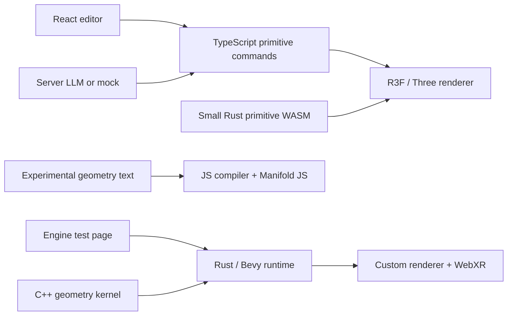
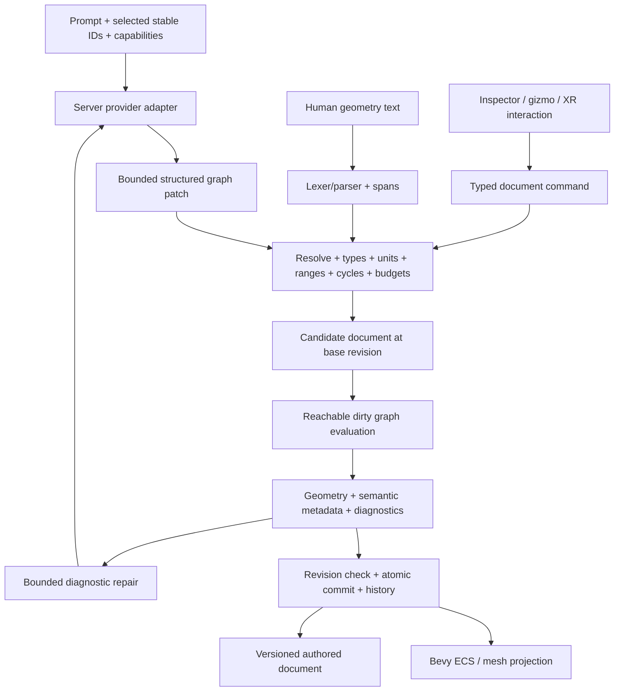

# Spatial Lab: code audit and language/geometry research handoff

**Date:** 2026-10-11. **Purpose:** give the implementing agent an evidence-based repair order and a proposed language architecture. This document contains research and recommendations; it does not implement the fixes or supersede accepted ADRs.

## 1. Read this first

The project has a useful engine foundation, but three separate implementations currently exist: the React/R3F editor, the Bevy engine harness, and the JavaScript geometry-language experiment. They are not yet one working LLM-to-Bevy authoring pipeline.

My recommendation is to **retain the trimmed Bevy runtime through its hardware gate, implement one Rust-owned typed document/command system, and compile both textual geometry programs and structured LLM patches into the same validated graph**. Expensive geometry evaluation needs an independently cancellable execution boundary. Preserve assemblies, instances, parts, and sockets as authored data instead of flattening everything into one solid.

Immediate priorities:

1. Repair the quality governor, XR session cleanup, actual XR resolution switching, cylinder axis contract, and normal transforms.
2. Correct benchmark measurements before using them to decide whether Bevy is viable on Quest.
3. Treat the language spike as experimental evidence. Its expression evaluator is unsafe for untrusted input, and several advertised operations have incomplete semantics.
4. Define stable IDs, revisions, graph types, resource limits, and registry-generated schemas before adding more language operations.
5. Complete one small authoring slice through the actual engine: create an assembly, edit one parameter, select a part, undo, save, reload, and edit again through its original ID.

### Snapshot and confidence

- Initial audit snapshot: `706b787925b7ea0b481f831d8955b713994e5b7d` — M9a performance statistics/governor.
- During the audit another agent committed `7ed86bafb97565f26648844c681532779d8ad83a` — M9b LAN testing and benchmark reports. Its changes were inspected separately and are included below.
- Untracked `engine/crates/ve-interact/` appeared during the audit. It is active work, not a completed or fully reviewed subsystem. Do not overwrite it.
- Further interaction files, lockfile changes and boundary-rule edits appeared while this report was being written. Findings about that work are provisional observations of the files read, not a verdict on the other agent's eventual commit.
- The full engine gate passed during this interval. This was a live shared checkout, not a hermetic build of a frozen commit; repeat the gate on the final implementation commit.
- **Reproduced** means a targeted local probe produced the stated result. **Source-confirmed** means the behavior follows directly from the inspected implementation. **Risk/proposal** means it still needs a targeted measurement or implementation decision.
- This is a bounded engineering audit, not proof that all bugs or vulnerabilities have been found. No physical headset, production provider, long thermal run, or complete cross-browser UI review was performed.

### Checks actually run

| Check | Result and limits |
|---|---|
| `cd engine && cargo xtask check` | Passed: 88 tests, formatting/clippy, configured dependency checks, C++ sanitizer checks, native/WASM parity, browser engine/XR/layer/quality/performance and benchmark-session checks, repository rules. Log: `/tmp/spatial-handoff-check.log` on the audit machine. |
| `bun run build` at repository root | Passed; includes primitive WASM build and TypeScript check. Vite reported large chunks and a removable Zod annotation warning. Log: `/tmp/spatial-handoff-app-build.log`. |
| Governor probe using the current Rust source | After overload, 60,000 perfectly paced 72 Hz intervals did not recover quality. Alternating ±0.1 ms jitter at 72 Hz reduced quality to the lowest tier. |
| XR bridge setup-failure probe | A rejected reference-space request left the acquired session unended: `session.end()` calls = 0. |
| Language compiler/evaluator probes | Confirmed the cases in section 5 and the reproducible examples in section 12. |
| LAN path decoder probe | Malformed percent encoding throws `URIError` from `safeJoin`; its HTTP caller invokes it outside the error handler. |

The engine browser run used Chromium/SwiftShader. Its boot result, approximately 387 ms, and frame timings are **not Quest results**. The reported ~60.6 MB WASM was a development artifact with debug information, not a measurement against the production Brotli budget. The root editor build emitted an approximately 1.49 MB main JavaScript chunk before compression plus separately emitted XR emulation chunks; emitted bytes are not necessarily initial downloaded bytes.

## 2. Current architecture and authority

Read these before implementing:

- [ADR 0001: trimmed Bevy engine](../engine/docs/adr/0001-single-engine-bevy-fork.md).
- [ADR 0002: textual geometry node graph](../engine/docs/adr/0002-node-graph-geometry-language.md).
- [ADR 0003: licensing and generated assets](../engine/docs/adr/0003-licensing-and-no-imported-assets.md).
- [Track 1 runtime plan](../engine/docs/plans/track1-runtime.md).

Track 1 explicitly defers language growth, AI, solvers, and editor integration. The proposed language work below belongs in a follow-on plan. Record ADR amendments for decisions that change the accepted single-engine/artifact or text-authoring assumptions. Keep the existing prohibition on GPL engine dependencies, external asset generation/import, and unapproved publication/deployment.

| Area | What exists | Assessment |
|---|---|---|
| Root editor: `src/`, `shared/`, `server/`, `rust/geometry/` | React/R3F scene, typed primitive commands, history/revision guard, local persistence, mock and configurable chat-completions adapter, Rust primitive vertices, XR integration, glass approximation. | Useful functional prototype. Its renderer and command schema are separate from the engine. |
| `engine/` | Rust workspace, trimmed vendored Bevy 0.20.0, custom forward renderer, C++ Manifold/meshoptimizer bridge, browser runner, stereo/XR layer, quality tiers, benchmark harness. | Substantial runtime groundwork. The application owns considerably more rendering/XR behavior than a standard Bevy application. |
| `spikes/geom-lang/` | Registry-driven text parser, simple types, JS Manifold evaluation, geometry diagnostics, generated sample programs. | Useful experiment; incomplete production semantics and isolation. Contributor rules require rewriting rather than importing spike code. |
| `docs/architecture.md` | Earlier broad architectural proposal. | Conflicts with newer accepted decisions, including rendering and WASM integration. Add a status banner/index explaining what has been superseded. |
| `engine/crates/ve-interact/` | In-progress picking/pose code appeared during review. | Coordinate before editing. Partial files are not evidence that M11 selection, manipulation, and hand interaction are finished. |



Do not maintain two authoritative scene documents after integration. The current React revision guard and transactional command validation are good behavior to preserve, not missing features to reinvent.

## 3. Runtime, XR, and Bevy findings

Priority definitions: **P0** blocks exposing untrusted generated programs; **P1** blocks a trustworthy runtime/authoring milestone; **P2** is hardening or the next integration step. A spike-only P0 is not a claim that the current root server is exploitable through that spike.

### R01 — P1: governor mistakes display pacing for available rendering time

**Reproduced.** [Governor](../engine/crates/ve-core/src/governor.rs), especially `up_headroom = 0.75` and `observe`; [runtime sampling](../engine/crates/ve-runtime/src/perf.rs), `track_frame_time`.

The input is the interval between frames. At a healthy 72 Hz cadence that interval is about 13.89 ms, even if rendering takes only 3 ms. Requiring the interval to fall below 75% of the display period makes recovery impossible in that case. The strict downshift boundary also treats small timing jitter as overload. The browser test's `?hz=5` creates an artificial 200 ms budget while callbacks are not paced at 5 Hz, concealing this distinction.

**Fix:** separate callback interval, CPU work duration, and optional GPU duration. Use sustained missed-budget evidence with a jitter margin. If only pacing is available, recover through a bounded higher-quality trial followed by rollback/backoff; stable pacing alone cannot measure spare GPU capacity. Use elapsed time for cooldowns, reset after visibility/session transitions, and explicitly handle refresh-rate changes. Define manual override behavior so an outstanding governor request cannot wait forever after being superseded.

GPU timing must be capability-detected, asynchronous, and discarded when disjoint; do not synchronously wait for query results or label CPU submit time as GPU time. [Khronos timer-query specification](https://registry.khronos.org/webgl/extensions/EXT_disjoint_timer_query_webgl2/).

**Accept:** ideal 72/90 Hz pacing and small jitter remain stable; overload reduces quality; recovery trials can restore it; hidden/resumed sessions and manual overrides do not wedge the controller. Test realistic paced traces separately from synthetic work-duration traces.

### R02 — P1: changing XR quality does not change the active layer's resolution

**Source-confirmed.** [Runtime quality](../engine/crates/ve-runtime/src/quality.rs), [XR bridge](../engine/crates/ve-xr-web/js/xr.js), [layer import](../engine/crates/ve-xr-web/src/layer.rs).

The framebuffer scale is used when creating the session layer. Later quality changes update configuration, but the bound layer is reused. A status value of `0.8` is not evidence of a reduced XR render workload.

**Fix options:** capability-detected per-view viewport scaling; independently scaled offscreen eye rendering with correct presentation mapping; or carefully recreating the layer and refreshing imported resources. Measure the tradeoff. A smaller viewport in a full-sized allocation reduces raster work without necessarily reducing allocated memory.

WebXR viewport scaling is requested before querying the viewport and may be constrained by the runtime. Treat it as a request, not a guaranteed size. [WebXR specification](https://www.w3.org/TR/webxr/).

**Accept:** change tiers during one live session and record actual eye viewport sizes, offscreen dimensions, MSAA allocations, and presentation correctness. Include repeated toggles and both eyes; checking the configuration struct is insufficient.

### R03 — P1: partial XR setup leaks a session; lifecycle ownership is incomplete

**Reproduced/source-confirmed.** [JS request path](../engine/crates/ve-xr-web/js/xr.js), [session ownership](../engine/crates/ve-xr-web/src/session.rs).

After `requestSession` succeeds, layer/reference-space failures lack a cleanup path. Support probing before entering the requesting state also leaves a reentrancy window. `makeXRCompatible()` is awaited before the session request; verify gesture activation survives on target browsers. Rust's active bridge/closures also need explicit end/disposal ownership.

**Fix:** cache capability probing, transition to requesting before asynchronous work, request the session from the activation handler, and end any acquired session on later failure. Make disposal idempotent. Detach listeners and release retained callbacks safely; avoid dropping a Rust closure while it is executing. A deferred cleanup step may be necessary.

Session creation requires appropriate user activation; capability detection is not a guarantee that creation succeeds. [WebXR specification](https://www.w3.org/TR/webxr/).

**Accept:** double-click, request denial, reference-space rejection, layer construction failure, browser-initiated end, repeated enter/exit, and context loss leave exactly one valid runner and no abandoned session.

### R04 — P1: nonuniform scale produces incorrect normals

**Source-confirmed.** [Forward shader](../engine/crates/ve-render/src/shaders/forward.wgsl), vertex normal transform around line 62.

Normals use the model matrix's upper-left 3×3. That is incorrect for general nonuniform scale. Use an inverse-transpose normal matrix, preferably prepared once per changed instance. Define reflected-transform winding/culling behavior. Guard singular transforms: current controller wands hide by setting scale to zero, so blindly inverting every model matrix introduces another failure.

**Accept:** curved geometry under `[2, 1, 0.5]` has correct lighting; reflected transforms have intentional visibility; hidden wands generate no invalid matrices. Use explicit visibility instead of degenerate transforms where practical.

### R05 — P1: cylinder coordinate contract disagrees with the kernel

**Source-confirmed.** [Rust `Solid::cylinder`](../engine/crates/ve-kernel/src/solid.rs) documents Y-up; [C++ kernel](../engine/cpp/src/kernel.cpp) directly invokes Manifold's Z-axis cylinder. The language spike already applies its own upright conversion, so the implementations disagree.

**Fix:** convert at one documented kernel boundary and apply the same coordinate convention to profiles, rotations, winding, sockets, and bounds. Preserve low/high radius meaning for cones.

**Accept:** a height-3, radius-0.5 cylinder has extent approximately `[1, 3, 1]`; test centered/non-centered cylinders, unequal radii, and native/WASM parity. Use suitable tessellation tolerances.

### R06 — P1: XR eye placement and shadow/light selection use different camera state

**Source-confirmed.** [View/light preparation](../engine/crates/ve-render/src/prepare.rs), [shadow preparation](../engine/crates/ve-render/src/shadow.rs), [XR application](../engine/crates/ve-xr-web/src/plugin.rs).

Stereo view uniforms use XR eye poses, while nearest-light selection and shadow centering use `ExtractedView` from the desktop camera. Updating `StereoViews` does not itself update that camera transform. A moving head/rig can therefore see lighting decisions based on the old location.

**Fix:** derive a shared view-family description from the actual eye poses. Select bounded lights for that family and fit shadow coverage to its intended region. Do not select an arbitrary first view if multiple cameras are supported.

**Accept:** translating the head and rig changes light selection and shadow coverage consistently, including objects visible to only one eye.

### R07 — P1: implicit schedule ordering and lost tracking can yield stale interaction state

**Source-confirmed ordering gap; visible consequences need targeted tests.** [App systems](../engine/crates/ve-runtime/src/app.rs), [XR plugin](../engine/crates/ve-xr-web/src/plugin.rs), [wands](../engine/crates/ve-runtime/src/wands.rs).

The update tuple and independently registered XR systems lack explicit semantic ordering. Resource conflicts prevent unsafe simultaneous access; they do not express the required frame sequence. Also, a missing head pose can cause the frame read to return without replacing prior controller state.

**Fix:** define ordered system sets: receive frame/input → apply rig/poses → interaction → commit changes → propagate/extract → publish status. Publish tracking validity every frame; cancel grabs on tracking loss, source removal, and session end. Use stable input-source IDs rather than handedness alone. Define select/squeeze edge semantics before M11 grows around button-index assumptions. Bevy provides ordering and chaining APIs for these relationships. [Pinned Bevy schedule API source](https://github.com/bevyengine/bevy/blob/v0.20.0/crates/bevy_ecs/src/schedule/config.rs).

**Accept:** controller transforms use the same frame as the head; tracking loss clears hover/held state once; removing and readding a controller does not transfer a grab accidentally.

### R08 — P1: benchmark labels and session reports overstate what is measured

**Source-confirmed.** [Performance state](../engine/crates/ve-runtime/src/perf.rs), [frame statistics](../engine/crates/ve-core/src/frame_stats.rs), [benchmark page](../engine/web/bench.js).

- Scene `draws` describes mesh/batch counts, not all submitted GPU draws. Stereo, shadow, and presentation passes multiply work.
- A long interval counts as one dropped event even when it spans several display periods. This is not compositor dropped-frame telemetry.
- Report duration begins when the watcher is created, before VR entry. Re-entering accumulates timeline/worst-window state. Statistics polled every 500 ms may miss the last frames before reset on session end.
- The benchmark scene intentionally uses distinct meshes. Add a shared-mesh instancing case as a separate workload.

**Fix:** distinguish authored instances, unique meshes, visible batches, submitted draws by pass/eye, submitted triangles, late callbacks, and estimated missed periods. Reset report state on each session start, capture a final immutable runtime snapshot before reset, and measure the session duration from presentation start. Include commit, build profile, browser/device, actual refresh rate, viewport dimensions, warmup, quality timeline, and thermal-run duration.

**Accept:** two consecutive sessions produce independent reports; delayed entry does not inflate runtime; report totals reconcile with pass instrumentation. Never equate IWER/SwiftShader measurements with headset performance.

### R09 — P2: scalability and framebuffer integration still need measurement

**Source-confirmed omissions / hardware risks.** [Extraction](../engine/crates/ve-render/src/extract.rs), [targets](../engine/crates/ve-render/src/targets.rs), [passes](../engine/crates/ve-render/src/pass.rs), [XR import](../engine/crates/ve-xr-web/src/layer.rs).

The custom path does not yet perform full view-frustum culling, retains costs from Bevy's render plumbing alongside its own targets, and does repeated extraction/preparation work. Profile uploads, allocations, target residency, bind-group changes, sorting, and status serialization before choosing optimizations.

Cull main geometry against the union of both eye frusta. Shadow casters need their own visibility test; limiting them to main-view-visible objects loses offscreen shadows. Prefer dirty updates and shared meshes. Consider throttling UI telemetry independently of frame-critical data.

The emulated layer test uses a normal RGBA framebuffer and does not establish real opaque-framebuffer behavior. WebXR owns that framebuffer; its valid use is constrained to the XR frame, and attachment inspection/deletion is restricted. `alpha: false` also deserves an explicit format/encoding compatibility audit against the imported wgpu representation. These are hardware checks, not proof of a current device failure. [WebXR specification](https://www.w3.org/TR/webxr/).

Multiview should remain conditional on measurements and detected support. A two-eye loop is not multiview. [Khronos OVR_multiview2 specification](https://registry.khronos.org/webgl/extensions/OVR_multiview2/).

### R10 — P2: new interaction work should validate transform invariants at its boundary

**Provisional review of active, untracked files.** `ve-interact/src/pose.rs` and `geometry.rs`.

`Pose::from_matrix` checks finite input but then decomposes and normalizes without checking singularity or the resulting quaternion. A finite matrix can be degenerate. `Shape::from_local_bounds` describes general transforms but decomposition into an OBB cannot exactly represent shear, including shear produced by rotated children under nonuniformly scaled parents. Public fields also allow bypassing constructor invariants. Quaternion component equality treats `q` and `-q` as different rotations.

Before integration, choose supported transform classes, return errors for invalid decomposition, validate bounds/shape constructors, and compare rotational equivalence appropriately. For general affine box picking, transform the ray into local space with a checked inverse and preserve the world-distance relationship; do not silently approximate shear as an exact OBB. Test zero scale, reflection, invalid quaternions, near-parallel rays, and parent/child transforms.

## 4. Build, FFI, application, and tooling issues

| ID / priority | Evidence and consequence | Concrete fix / acceptance |
|---|---|---|
| B01 / P1 before untrusted geometry | [`Solid` and `simplify`](../engine/crates/ve-kernel/src/solid.rs) have useful checks, but finite `f64` values can exceed renderable `f32` ranges. `simplify` does not mirror the finite-position check in `from_mesh`. Large segment/mesh ceilings are not a practical per-job budget. | Bound dimensions, coordinates, intermediate complexity and output bytes; use checked products/conversions before allocating or entering the kernel; reject nonfinite output. Test extreme finite values, NaN mesh input, and huge nested operations without attempting destructive OOM probes. |
| B02 / P1 before generated workloads | Synchronous C++ work cannot be stopped by a JS promise timeout. A kernel allocation failure/abort is not reliably recoverable in-process. | Use explicit ownership, narrow imports, preflight quotas, worker termination/recreation, and typed failure results. Do not use `catch_unwind` as recovery from an aborting build. [Rust FFI guidance](https://doc.rust-lang.org/nomicon/ffi.html). |
| B03 / P2 | [`build.rs`](../engine/crates/ve-kernel-sys/build.rs) watches `cpp`, Manifold source/include and meshoptimizer source; it omits Clipper2 and relevant vendored build configuration. | Watch all actual CMake inputs, or use a maintained content manifest. A changed vendor header/config must trigger a rebuild without `cargo clean`. Audit the WASI shim's supported imports/clock IDs and constructor initialization separately. |
| B04 / P1 for release evidence | [`xtask`](../engine/xtask/src/main.rs) can skip missing tools and still print “all gates passed.” `cargo deny` is invoked for licenses/bans/sources, not advisories. [`web.rs`](../engine/xtask/src/web.rs) uses `npm install`, unlike the user's Bun preference. | Distinguish strict gates from optional local checks; record pass/fail/skip and require mandatory tools in the strict path. Add an explicit advisory check and vendor inventory. Use a committed Bun lockfile and frozen installs for JS workspaces. `cargo-deny` advisory checking is a separate check family. [Official documentation](https://embarkstudios.github.io/cargo-deny/checks/advisories/index.html). |
| B05 / P2 | Current budgets cite an early trimmed-Bevy spike; the gate builds a dev engine artifact. Rules enumerate pure crates and inspect boundaries, so newly added crates can escape the intended category. | Measure the actual release WASM/Brotli artifact, startup and memory. Extend boundary checks for new crates, including transitive prohibited dependencies where appropriate. Track both Rust and C++ vendor provenance/licenses; Cargo checks alone do not inventory C++ sources. |
| B06 / P1 for reliable LAN testing | [`safeJoin`](../engine/tools/serve-lan.mjs) throws on malformed URL encoding outside the HTTP handler's `try`. Default binding is all interfaces; `/report` has a per-request cap but no total retention limit. | Catch decoding errors and return 400 without terminating the server. Add bounded report retention, schema validation and filename collision handling. Use realpath containment if symlinks can enter the served directory. Keep localhost the default unless LAN access is intentionally requested. Test malformed URLs and repeated uploads. |
| B07 / P2 | LAN certificates are reused based on names, without expiry renewal. Bypassing a self-signed warning should not be assumed to provide identical WebXR behavior on all browsers. | Check certificate validity; document the actual target-browser procedure. Prefer the existing USB/localhost route for reproducible testing and verify `isSecureContext` plus session creation on the headset. |
| A01 / P1 integration | Root `factoryIds`, factory registrations and the server prompt are independently maintained. Prompt says maximum 60 commands; response schema permits 100. Engine and spike schemas differ again. | Generate supported capability/schema material from one registry; distinguish provider schema, semantic validation and resource limits. Add a registry/schema drift check. |
| A02 / P2 | [`ChatCompletionsAdapter`](../server/adapters.ts) uses JSON-object mode, one protocol and one hardcoded prompt. It validates afterward, which is good, but does not explicitly handle finish reasons/refusal, response byte limits or repair attempts. | Add provider capability metadata, bounded output and structured error mapping, request cancellation and finite repair. Preserve server-only keys and clearly labelled mock mode. Do not call a compatible endpoint proof of support for every provider. |
| A03 / P2 | [`App.tsx`](../src/App.tsx) already rejects stale responses by revision and uses a single active chat request. Save documents contain only primitive objects. Invalid startup storage silently falls back to a starter scene. | Preserve revision checks during migration; add request/project IDs and canonical command envelopes. Version/migrate saved graph documents. Keep corrupt data recoverable and show a notice. Test denied storage/quota and reload after schema changes. Use IndexedDB only when document size or atomic multi-record persistence warrants it. |
| A04 / P2 | Root build succeeds but contains substantial R3F/XR/emulation output while a second renderer is being developed. | Decide the migration seam. Keep the UI while swapping the viewport bridge, then remove unused renderer/emulation dependencies once feature parity is established. Measure actual initial requests before optimizing chunks. |
| A05 / P2 | [Glass implementation notes](liquid-glass.md) describe real displacement optics and preference fallbacks; this is more than a blur-only mockup. It is still an approximation and has not been revalidated across browsers/headsets here. | Test contrast over light/dark/moving geometry, focus, zoom, reduced transparency/motion and compositor cost. Keep text sharp and avoid nested glass. World-space XR panels need their own rendering/input design; CSS glass does not automatically appear in immersive VR. Apple's material is a functional control layer above content. [Apple's presentation](https://developer.apple.com/videos/play/wwdc2025/219/). |

## 5. Geometry-language findings

Primary local sources: [`lang.mjs`](../spikes/geom-lang/lang.mjs), [`eval.mjs`](../spikes/geom-lang/eval.mjs), and [`score.mjs`](../spikes/geom-lang/runs/score.mjs).

### G01 — P0 before exposure: `sd_expr` executes host JavaScript

**Reproduced.** A character allowlist feeds `new Function`. It permits property access and assignment. Evaluating `(globalThis.__spatialAuditMarker=7,length(x,y,z)-0.5)` successfully changed a global variable during meshing.

Replace this with a small expression parser and evaluator: finite literals, bound variables `x/y/z`, explicit arithmetic/comparison operators if needed, and registered pure functions with known arities. Exclude property access, arbitrary calls, assignments, dynamic code, imports, and host globals. Bound expression depth and evaluation cost. Running the same unsafe JavaScript in a worker is not a sufficient security boundary.

This finding is confined to the experiment as inspected; the root LLM server does not currently call this evaluator.

### G02 — P1: validation accepts invalid numbers and malformed geometry inputs

**Reproduced:** `1e999`, negative radii, zero segments, fractional/negative array counts, and malformed polygon coordinate tuples compile. Duplicate parameters overwrite earlier values. Multiple output statements select the last one. `constructor()` reaches an inherited object property and crashes the compiler rather than returning a diagnostic.

Use a real registry map, finite/ranged newtypes, dimension-specific vectors, bounded integer counts, explicit enum values, and duplicate detection. A parser error must always be a result with a source span. Reject invalid values before C++/WASM evaluation.

### G03 — P1: parser behavior and diagnostics are too weak for repair loops

The comment regex strips `#` inside quoted strings; string escapes and delimiter handling are incomplete. Evaluation failures lose the node location (`ln: 0`), and compile/final mesh extraction exceptions are outside the evaluator's catch block.

Write a small lexer/parser with byte spans and explicit grammar. Return structured errors containing stage, code, node ID, parameter path, expected/actual values, and actionable constraints. Do not turn every internal error into a vague “try again” message.

### G04 — P1: advertised capabilities do not match implemented semantics

`bevel` always throws; `rect.corner` is ignored; `hollow` subtracts a bounding-box-scaled copy and therefore does not promise constant wall thickness; `simplify.ratio` is converted to a heuristic tolerance rather than a guaranteed target ratio. Some invalid dimensions are silently clamped.

Add capability states such as implemented/experimental/unavailable. Generate LLM capability lists from the implemented subset. Either implement the declared semantics or rename the operation so its guarantee is honest. Add a semantic contract test for every advertised parameter.

### G05 — P1: unused nodes still execute

**Reproduced.** An unused `bevel` node makes an otherwise valid box output fail. The compiler calculates reachability for warnings, but evaluation loops over all nodes.

Validate the document consistently, then evaluate only the selected output's dependency closure. Require pure geometry operators; metadata belongs in graph values so removing unreachable nodes also removes their metadata. Test that an expensive or unsupported unused operation is never invoked.

### G06 — P1: parts, sockets and materials are not durable geometry values

**Reproduced/source-confirmed.** A socket remains at `[0, 0.5, 0]` after its owning solid is moved upward by 2 m. Part names/bounds are collected globally, only names survive in the result, and collected material slots are not returned as a renderable material assignment.

Use typed result values containing geometry plus semantic IDs, local transforms, material bindings and provenance. Define propagation for transform, boolean, instance, merge and simplification. Sockets need a local frame, including orientation/tangent information if attachment rotation matters; a position and normal alone do not determine full orientation. Booleans must report deleted/ambiguous features instead of retaining stale references.

### G07 — P1: signed-field scale and meshing semantics are incorrect/incomplete

**Reproduced.** A radius-0.5 field sphere reflected using scale `[-1,1,1]` changes from an approximately 1×1×1 sphere to a bounds-filling complement: at resolution 8 the reported volumes were approximately 0.492 versus 7.508 within a 2×2×2 box. Multiplication by `min(scale)` reverses the sign.

Reject zero factors; use absolute scale bounds for a conservative transformed field, and distinguish exact signed distance from a general implicit field. Nonuniform scale/noise/smooth operations need documented distance guarantees. Require finite evaluation bounds, resolution/error limits, and clipping diagnostics. Do not silently label all scalar fields exact SDFs.

The experiment's actual `mesh_sdf` uses `Manifold.levelSet`; a separate surface-nets helper is not the active mesher. Document the real backend before comparing algorithms.

### G08 — P2: sweeps/lofts need topology and frame correctness

Current helpers retain only the first contour, losing holes; fixed resampling and fan caps are insufficient for general concave profiles. Retrying winding combinations is not a complete correctness strategy. Path duplicates, sharp reversals and frame degeneracy require explicit behavior.

Start with a constrained supported subset. Add polygon triangulation with holes, profile correspondence rules, and well-defined path frames. Rotation-minimizing frames are a relevant approach for minimizing unintended sweep twist; the double-reflection method is described in the original research. [Wang et al., computation of rotation-minimizing frames](https://www.microsoft.com/en-us/research/wp-content/uploads/2016/12/Computation-of-rotation-minimizing-frames.pdf).

### G09 — P1 before scale: no effective resource budget; ownership needs hardening

Repetition and meshing can expand dramatically, including nested arrays and cubic grid sampling. Scatter translates and then rotates, rotating the placement offset as well as the object; this can move points outside the intended rectangle. Seeded algorithms need precisely defined integer arithmetic to reproduce results across JS/Rust/native/WASM.

The JS evaluator does not explicitly delete all intermediate Manifold/CrossSection handles, including failure paths. This is a cleanup risk, not a measured leak rate. Emscripten documents explicit lifetime management for owned Embind objects. The Rust/C++ implementation should use RAII with bounded caches and failure cleanup. [Embind memory management](https://emscripten.org/docs/porting/connecting_cpp_and_javascript/embind.html#memory-management).

### G10 — P1 for product claims: geometry diagnostics and scoring do not establish intent fidelity

An AABB gap is a cheap lower bound, not proof of contact or connectivity. Overlapping bounds can conceal separated solids. A watertight object can still be the wrong object. Separate surfaces or disconnected components may be intentional in an assembly.

The scoring script compiles saved programs, including repaired batches. It does not by itself record initial provider responses, repair attempts, execution success, latency or prompt adherence. Do not report that as a measured first-attempt LLM success rate.

Evaluate first response and repaired response separately. Preserve prompt/model/settings/registry version/seed, every patch and diagnostic, geometry metrics, visual samples and edit-locality checks. Define when contact is required by a relationship instead of globally penalizing disconnected parts.

## 6. Recommended language pipeline

### 6.1 Two authoring frontends, one semantic graph

Use the accepted readable textual node language for human authoring and inspection. For LLM transport, prefer schema-constrained **graph patches** referencing stable IDs. Both paths compile into the same typed intermediate representation (IR). A future node editor edits that same graph.

This is a proposed refinement of ADR 0002, not an instruction to abandon text. Explicitly decide whether persisted canonical graph data plus text, or lossless text plus ID annotations, owns the saved document. My preference is a versioned semantic graph with retained authoring text/source mappings. Unsaved invalid text is editor state; it must not corrupt the last committed graph.

| Option | Judgment for this project |
|---|---|
| Unrestricted JavaScript/Python/Rust generated by the LLM | Excess authority, weak cost control and difficult incremental edits. Exclude from the initial language. |
| Small typed text DSL only | Readable and consistent with the ADR. Needs stable identity, real parsing, spans and patch semantics. |
| Structured graph JSON only | Easier schema validation and patching; verbose for people. Useful transport and persistence representation. |
| Text + structured patches + shared typed IR | Recommended. One meaning and validator with different authoring interfaces. |
| Full LLVM/MLIR or a general node-execution framework | Premature dependency/complexity for this slice. Borrow operation-registry and lowering principles first. |

MLIR's declarative operation definitions demonstrate how one specification can drive verification, builders, parsing and documentation. Apply that principle with a small Rust registry; it does not require adopting MLIR. [MLIR operation definitions](https://mlir.llvm.org/docs/DefiningDialects/Operations/).



For simple transform-only edits, validation/commit can avoid geometry evaluation entirely. For expensive edits, keep candidate results staged and recheck revision immediately before publishing.

### 6.2 Registry contract

Each registered operator should declare:

- Namespaced name and semantic version, e.g. `geom.box@1`.
- Named input/output ports and concrete types.
- Parameter types, units, finite bounds, defaults and enum values.
- Cross-parameter constraints and checked resource-cost estimates.
- Purity/determinism, seed requirements and supported execution backends.
- Geometry guarantees: closed solid, open surface, approximate field, preserved instances, etc.
- Metadata/provenance propagation rules.
- Implementation readiness and diagnostic codes.
- Contract examples and native/WASM tests.

Generate TypeScript types, JSON Schema, inspector fields, text help, LLM capability descriptions and a capability hash from this source. Avoid separate hand-maintained prompt lists. The server may enforce generated structural schemas; the canonical Rust compiler remains authoritative for graph semantics. A native/WASM compiler build may be reused server-side if server semantic preflight is needed.

Suggested initial values: `Scalar<Unit>`, bounded `Count`, `Vec3<Unit>`, `Angle`, `Transform`, `Profile2`, `Curve3`, `Solid`, `SurfaceMesh`, `Assembly`, and `Instances<T>`. Add typed fields only when their evaluator is ready. An open plane must not be coerced into a closed solid; terrain/sheets need open-surface semantics. Representation conversions should be explicit.

Freeze meters, handedness, Y-up, transform composition order, rotation convention and color encoding. The existing root editor uses radians while the spike/kernel API uses degrees. Convert at explicit boundaries; do not pass an unlabelled `vec3` through all three.

### 6.3 Compiler passes and bounded evaluation

1. Enforce source/JSON byte and nesting limits before parsing.
2. Parse with spans; reject duplicate keys, declarations and output ambiguity.
3. Resolve names and stable IDs using a real map.
4. Check port types, units, finite values, bounds and semantic constraints.
5. Check cycles and compute a deterministic topological order without unbounded recursive descent through the graph.
6. Determine reachable outputs and estimate cost, including nested multiplicative expansion.
7. Evaluate changed dependencies only, under memory/time/output limits.
8. Validate geometry output: finite coordinates, valid indices, intentional emptiness, topology contract, bounds, and metadata consistency.
9. Produce structured diagnostics and a staged scene diff.
10. Recheck revision and atomically commit; failure leaves the document/history untouched.

Start with an explicit dirty DAG and bounded cache. Salsa is a useful reference for incremental computation, but its default caching and cancellation model require deliberate policy; its documented cancellation uses unwinding and cannot interrupt an opaque C++ call mid-operation. [Salsa tuning](https://salsa-rs.github.io/salsa/tuning.html).

### 6.4 Stable identity and a shared command envelope

Separate `ProjectId`, `ObjectId`, `GraphId`, `NodeId`, `PartId`, `SocketId`, `MaterialId`, and transient Bevy entities/kernel handles. Renaming a label must preserve identity. New IDs should be allocated or reserved by the host; a model can refer to temporary aliases that the host resolves atomically.

Illustrative **proposed** wire contract, not an existing API:

```json
{
  "schemaVersion": 1,
  "projectId": "project-17",
  "requestId": "request-203",
  "transactionId": "transaction-91",
  "baseRevision": 42,
  "capabilityHash": "registry-hash",
  "operations": [
    {
      "type": "setParameter",
      "graphId": "table-geometry",
      "nodeId": "top-box",
      "parameter": "size",
      "value": { "unit": "m", "value": [1.6, 0.08, 0.8] }
    }
  ]
}
```

The same transaction service handles AI patches, text recompilation, inspector changes, undo/redo and XR commits. Reject stale revisions and wrong projects/capability versions. Support idempotent transaction IDs. Never accept a delayed evaluation because a deleted/recreated object happens to reuse an ID.

Dragging should update transient preview state and commit one authored transaction at gesture end. Parameter edits must update the parameter/constraint model, not just overwrite derived vertices. If a gizmo conflicts with a relationship, explicitly pin, override or release that relationship.

Snapshot history is acceptable initially if bounded. Introduce structural sharing or inverse operations when measured memory justifies it. Do not persist raw ECS entities, pointers, transient meshes or worker handles as identity.

## 7. Geometry strategy: composition, topology, fields, and metadata

### 7.1 Separate world planning from local shape construction

Use a small scene plan for objects, relationships and placement intent; use a geometry graph for local shapes and parameters. A material graph can later describe surface appearance. Runtime behavior/logic is another effect domain and should not execute as an unbounded geometry operation.

The model may propose local dimensions, points and transforms as validated data. World placement can use constraints such as `on`, `attachedTo`, clearance and alignment. Reconcile this with the older architecture document's broad “LLM does not choose coordinates” language in an ADR. A minimal deterministic placement system is enough initially; a general solver is future work.

### 7.2 Choose representation according to the operation

| Need | Recommended representation | Important boundary |
|---|---|---|
| Manufactured primitive objects and holes | Manifold solids, profiles/extrusion, explicit CSG | A manifold result does not guarantee correct intent, dimensions or contact. |
| Chair/table/door with independently editable parts | Assembly of named parts with local transforms | Preserve part identity; union only when fused geometry is requested. |
| Repeated bolts, slats, trees | Shared prototype plus instances | Avoid materializing/unioning every copy. Make per-instance overrides explicit. |
| Planes, sheets, terrain | Open surface mesh/height field | Do not pretend it is a closed volume. |
| Organic blending and procedural volumes | Bounded scalar fields with explicit meshing | Carry approximation/error and bounds; topology can change with resolution. |
| Bevels, true offsets, general sweeps | Dedicated, constrained operators | Do not advertise a visual heuristic as a robust offset/bevel implementation. |

Manifold provides robust solid operations and mesh provenance fields; those capabilities do not supply the application's semantic part system automatically. [Manifold documentation](https://manifoldcad.org/docs/html/), [MeshGL provenance fields](https://manifoldcad.org/docs/html/structmanifold_1_1_mesh_g_l_p.html).

Shared prototypes reduce duplicate scene structure; instance overrides require explicit rules. OpenUSD is a useful design reference for that tradeoff, without adding USD or imported assets to this project. [OpenUSD instancing](https://openusd.org/23.05/api/_usd__page__scenegraph_instancing.html).

### 7.3 Parameters and reusable graph definitions

A table should expose width, depth, top thickness, leg height and offsets as bounded typed parameters. A follow-up “make it wider” changes width and recomputes dependent geometry. Reusable graph definitions should have typed inputs, outputs and namespaced internal IDs; instances reference them with overrides.

Start without recursion or general loops. Repetition is a bounded operator with an explicit cost. Editing “this leg” versus “all legs” must select instance override versus prototype modification, with copy-on-write where needed.

### 7.4 Feature provenance and sockets

Use semantic feature names/IDs, such as `top.upperSurface` or `door.hingeSocket`, as authored references. Map them to generated geometry during evaluation. KCL's typed/tagged references are a useful precedent for avoiding untyped face-name strings. [KCL values and types](https://docs.zoo.dev/docs/kcl-lang/types).

Preserve kernel provenance where available, but do not persist raw triangle indices or assume kernel-generated IDs survive every operation or process restart. A boolean can split, merge or delete a feature. Return an explicit ambiguous/missing-feature diagnostic and let the edit or repair loop resolve it.

Sockets should be local frames tied to stable parts. Transform them with the owning part; transform surface normals appropriately under nonuniform scale. Define whether scaling an attachment frame changes connector dimensions. This supports later relationships and hinges without introducing a full physics system now.

### 7.5 Fields and future geometry-node expressiveness

A scalar parameter is one value. A field is a function evaluated over a domain such as positions, vertices, faces or instances. If field nodes are added, type the domain and result (`Field<Position3, Scalar>`, for example), define attribute lookup and interpolation, and make domain conversion explicit. Do not overload ordinary numbers/arrays with implicit per-element execution.

Keep field evaluation pure, bounded and deterministic. Restrict GPU shader generation to trusted node templates with validated inputs. First implement a few proven fields and sampling operations; a Blender-scale geometry-node ecosystem is a long-term project.

## 8. Execution, memory, and cache design

**Proposed ADR change:** retain one engine codebase, but isolate long geometry jobs from the window's XR loop. The current single browser WASM artifact does not by itself give cancellable geometry evaluation.

| Context | Responsibility |
|---|---|
| Browser window / engine runtime | XR session and frame loop, input, authoritative document revision/history, lightweight transforms, rendering and bounded mesh uploads. |
| One geometry worker initially | Compile/evaluate candidate graphs, retain bounded intermediate cache, return transferable mesh/metadata results. No authoritative competing document. |
| Existing server | Provider calls, secrets, request/output limits, protocol normalization, generated-schema validation and optional semantic preflight. |

A geometry-only WASM build from shared Rust crates is likely simpler and smaller than instantiating the entire renderer twice. If the one-artifact constraint remains, measure a worker-compatible entry point in the same module and its duplicate initialization/memory cost. Record the choice; do not silently change the accepted architecture.

Workers support independent long computations and termination. A promise timeout on the main thread does not stop synchronous work elsewhere. Use cooperative cancellation between operations and terminate/recreate the worker for an unresponsive kernel call. A worker also has overhead, so start with one bounded queue. [HTML worker specification](https://html.spec.whatwg.org/multipage/workers.html#dom-worker-terminate).

The WebXR interface is exposed on the window; do not assume a worker can directly own the same session API. [WebXR specification](https://www.w3.org/TR/webxr/).

Required policies:

- Per-job source size, graph nodes/depth, expanded instances, sampling cells, mesh bytes and deadline limits. Set initial conservative limits, measure representative tasks, and document adjustments.
- Latest-request supersession; stale worker results never mutate the scene. Keep the last valid mesh visible while a new result is staged.
- Bounded mesh uploads per frame so a successful worker result cannot create a long XR stall.
- Cache keys include normalized typed parameters, upstream geometry hashes, operator version, kernel/build ABI, seed, tolerance and quality settings. Metadata/provenance changes may need a distinct hash from reusable mesh geometry.
- Use a defined canonical serialization, not incidental map insertion order or cross-language `JSON.stringify`. RFC 8785 is one reference if canonical JSON is chosen. [JSON canonicalization](https://www.rfc-editor.org/info/rfc8785/).
- Bound cache bytes and release C++ objects on eviction/error. Budget document history separately from derived geometry. Recycle a worker after excessive memory growth or fatal failure.
- Avoid retaining WASM-memory views across allocations/growth. Transfer owned output buffers with explicit ownership; do not transfer the live WASM heap.
- Defer shared-memory threads until measurements justify their isolation/header/compatibility requirements. A worker and a pure WASM import surface are different controls; neither licenses arbitrary host-language execution.

## 9. LLM generation and repair pipeline

### Provider contract

Keep the server adapter replaceable. Normalize successful structured output, refusal, truncation, malformed output, transient provider error and cancellation into explicit result variants. Configure models outside the geometry compiler. Generate schemas from the runtime capability registry and adapt them to the subset each provider supports.

Provider-constrained JSON reduces syntax errors but does not establish geometric or business correctness. The provider documentation explicitly calls for application validation of semantic values. [Google structured-output guidance](https://ai.google.dev/gemini-api/docs/structured-output).

### Request context

Send the user's request, selected stable IDs, relevant object/part summaries, dimensions/units, graph parameter definitions, current revision, and the supported capability subset. Include enough surrounding scene relationships to preserve intent. Avoid resending raw triangle arrays or unrelated document history.

Treat names, previous chat and diagnostics as data. The model can propose edits only through the registered command vocabulary. Server keys, filesystem/network access and arbitrary executable code are outside that vocabulary.

### Repair loop

1. Request a bounded patch against a specified revision.
2. Parse and validate structure and graph semantics.
3. Estimate cost and execute a staged candidate.
4. Evaluate topology, dimensional constraints, relationships and edit locality.
5. Return compact structured diagnostics to the model for a bounded number of repair attempts.
6. Commit only a successful current candidate. Otherwise keep the previous scene and explain the failing node/constraint.

A reasonable initial product policy is at most two repair attempts, configurable and measured; this is a proposed limit, not a research-established optimum. Cancel when the user changes the relevant document. Never stream half a transaction into the authoritative scene; incomplete streamed output may only drive a disposable preview.

The assistant's success message should follow a successful commit. Record attempts, latency, token/cost usage where available, operation counts, failure category and user-visible result. Redact secrets and avoid retaining unnecessary prompt content.

### Evaluation corpus

Include simple creation, composition, follow-up edits, selected-object pronouns, duplicate labels, rename, deletion, conflicting dimensions, unknown operations, oversized requests and malicious expressions. Compare first-attempt success, repaired success, semantic/visual quality, latency and edit locality separately. Use the same fixture inputs and registry version across providers.

## 10. Bevy decision and future risks

**Keep Bevy for now.** The current choice matches the accepted ADR, and the vendored 0.20.0 release exists upstream; the pinned source is the authority for APIs. [Bevy 0.20.0 release](https://github.com/bevyengine/bevy/releases/tag/v0.20.0).

The useful assets here are the ECS/scheduling/transforms/assets integration and a coherent runtime. However, this project owns its forward renderer, XR bridge, framebuffer import and patches. Bevy does not remove those maintenance obligations. Keep each vendor patch small, documented and backed by a regression test; maintain an upgrade/rebase checklist.

Run the planned Quest gate after R01–R08 corrections. Record S1/S2/S3 at fixed quality as well as adaptive quality, warmup and sustained thermal load, actual refresh rate, GPU/backend information, memory, repeated session transitions and visual correctness. Use the existing 72 Hz target, 90 Hz stretch and 30-minute memory stability goals as acceptance targets, not current achievements.

If the measured failure is avoidable Bevy target/extraction overhead, test removing that cost. If the custom renderer is the bottleneck, replacing Bevy may not solve it. Compare against the ADR's thin-wgpu fallback on identical content before making an architectural rewrite decision.

| Future pressure | Likely failure | Prevention / trigger |
|---|---|---|
| Larger procedural graphs | Exponential instances, repeated booleans, cache/OOM spikes | Preflight expansion, bounded DAG cache, shared prototypes, cancellation and measured quotas. |
| Better visual quality | Transparency sorting, normals/tangents, PBR/color-space mismatch | Explicit material contracts and render tests; schedule each feature with a budget. |
| Editing boolean results | Unstable face selections and broken attachments | Semantic feature IDs and provenance; explicit ambiguity diagnostics. |
| Very large/small objects | Precision loss, huge relative tolerances, z-fighting | Unit/scale envelopes now; local origins and scale-aware tolerances when required. |
| Provider changes | Schema support changes and behavioral regressions | Versioned adapters/capabilities and replayable evaluation corpus. |
| Document evolution | Old saves cannot load or change meaning | Schema/operator versions, migrations, immutable backups and deterministic fixtures. |
| Collaboration later | Lost updates, ID conflicts and divergent histories | Revisions/idempotency now; defer CRDT/OT until real collaboration requirements exist. |
| XR interruptions | Stuck selection, orphaned runners and stale GPU imports | Explicit lifecycle state machine and repeatable loss/resume tests. |
| Mobile resource pressure | Thermal throttling, context loss and browser eviction | Honest sustained benchmarks, restoration path, graceful quality policy and durable saves. |
| UI migration | Duplicate renderer/document stacks remain indefinitely | One integration seam, parity checklist and removal milestone for superseded code. |
| Broad “extensibility” work | Framework growth without a usable feature | Add each abstraction through one working authoring example and a contract test. |

Continue deferring neural asset generation, MCP, advanced polygon editing, physics/gameplay systems, authentication and deployment. The experiment's MCP-shaped script is not evidence of a production MCP integration and should not expand the current scope.

## 11. Implementation sequence for the receiving agent

### Stage A — make runtime evidence trustworthy

1. Re-read current worktree, AGENTS and Track 1; coordinate with the active M11 author.
2. Add focused regressions and fix R01–R08, B06 and the relevant kernel boundary checks.
3. Preserve existing scene goldens where correct; explicitly review intentional image changes.
4. Run the strict gate and produce accurately labelled benchmark reports.
5. Perform the physical Quest gate; record untested cases instead of marking them complete.

### Stage B — agree on the authored model

Write a short follow-on plan/ADR covering document authority, text/graph persistence, IDs/units, shared commands, worker packaging, limits and scene-versus-geometry ownership. Generate a registry/schema artifact and test its drift. Avoid building a general plugin loader or visual node editor at this stage.

### Stage C — one small geometry authoring slice

Implement a small honest subset: box, cylinder with the corrected axis, transform, assembly/part/socket, instances, and union/difference where needed. Add named typed parameters. Use the production Rust/kernel boundary, not spike imports.

Acceptance scenario:

1. A mock structured request creates a table assembly with stable top/leg IDs.
2. “Make the top wider” changes its width parameter while keeping the table/part IDs.
3. Inspector and gizmo edits enter the same transaction system.
4. Selection resolves rendered instances back to authored parts.
5. One undo reverses the entire edit; redo restores it.
6. Save/reload preserves graph, parameters, relationships and IDs.
7. A delayed response, invalid parameter or cancelled worker job leaves the document unchanged.
8. A live XR session continues responding while a geometry job is evaluated/cancelled.

### Stage D — provider and repair integration

Connect the existing server adapter to generated patch schemas, structured diagnostics and a bounded repair loop. Keep mock mode for deterministic tests. Measure first-attempt and repaired success separately. Only advertise operations the production evaluator supports.

### Stage E — expand from evidence

Add profiles/extrusions and constrained sweeps, then bounded fields/meshing as demonstrated needs arise. Add LOD, multiview, richer materials or incremental compiler machinery only when the measured bottleneck or product example justifies them.

### Test matrix to carry into implementation

| Layer | Focused acceptance coverage |
|---|---|
| Parser/registry | Unknown and inherited names; quotes/comments/escapes; duplicates; finite values; units; vector arity; enums; source spans; bounded nesting. |
| Graph/compiler | Cycles; stable IDs after rename; reachability; expansion budgets; deterministic order; schema/registry consistency; invalid draft leaves committed graph intact. |
| Geometry | Axis and bounds contracts; analytical primitive invariants within tolerance; transform/normal correctness; reflected fields; open/closed types; socket propagation; boolean feature ambiguity. |
| Native/WASM | Equivalent geometry invariants across targets; explicit tolerance. Do not require incidental triangle order to be identical unless that is a declared contract. |
| Incremental evaluation | Cached versus clean recomputation equivalence; transform-only edit avoids CSG; version/seed/tolerance invalidates cache; eviction frees ownership. |
| Commands/history | Atomic failure; stale revision/project; idempotency; one-gesture undo; instance versus prototype edit; save migration and corrupt/quota storage. |
| Worker/resources | Cancellation between nodes; termination during noncooperative work; bounded output/queue/cache; stale result discarded; runtime remains responsive. |
| Runtime/XR | Paced governor traces; live dimensions; ordering; tracking loss; setup rollback; repeated sessions; context recovery; real headset thermal/memory run. |
| LLM | Refusal/truncation/malformed output; unsupported schema/provider; bounded repair; wrong IDs; unrelated edits; deterministic mock replay. |

Add parser fuzzing and structure-aware graph/IR fuzzing under strict input budgets. Structured fuzz inputs reach deeper compiler invariants than malformed text alone. [Rust Fuzz Book](https://rust-fuzz.github.io/book/cargo-fuzz/structure-aware-fuzzing.html).

## 12. Minimal reproduction notes

These examples document the audited spike behavior. They are not proposed production syntax extensions. Run only in the local experiment with its existing dependencies; no provider/network request is needed.

### Parser probes

From the repository root, use Bun (or the existing Node runtime):

```sh
bun --input-type=module -e 'import {compile} from "./spikes/geom-lang/lang.mjs"; console.log(compile("a = sphere(radius=1e999)\noutput a"));'
```

Audited outcomes:

| Program fragment | Observed outcome | Required outcome |
|---|---|---|
| `a = sphere(radius=1e999)` | Compiles with infinite radius. | Finite-range diagnostic. |
| `a = sphere(radius=-1, segments=0)` | Compiles. | Radius/segments diagnostic. |
| `a = sphere(radius=1, radius=2)` | Last value wins. | Duplicate parameter diagnostic. |
| `p = polygon(points=[[0],[1]])` then extrude/output | Compiles. | Point arity/profile validity diagnostic. |
| `a = constructor()` | Throws `TypeError`. | Unknown operator diagnostic; no throw. |
| `material(a, slot="#ff0000")` | Comment stripping breaks parse. | Preserve the string token. |
| Two `output` declarations | Last wins. | Explicit multiple-output semantics or rejection. |

### Unreachable evaluator node

```text
a = box(size=[1,1,1])
b = bevel(a, radius=0.1)
output a
```

Observed: evaluator fails on unused `bevel`. Expected: output closure evaluates `a`; unavailable `b` is diagnosed according to compile policy but never executed.

### Socket propagation

```text
a = box(size=[1,1,1])
s = socket(a, name="top", at=[0,0.5,0])
m = move(s, by=[0,2,0])
output m
```

Observed final socket location `[0,0.5,0]`; expected output-space location `[0,2.5,0]`, or an explicit owner/local transform that resolves to it.

### Harmless proof that expression evaluation reaches the host

```text
f = sd_expr(expr="(globalThis.__spatialAuditMarker=7,length(x,y,z)-0.5)")
m = mesh_sdf(f, bounds=[2,2,2], resolution=8)
output m
```

Observed: evaluation succeeds and the host marker becomes `7`. No files, secrets or network were accessed by this probe. The required production behavior is rejection during expression parsing.

### Reflection semantics

```text
f = sd_sphere(radius=0.5)
s = scale(f, by=[-1,1,1])
m = mesh_sdf(s, bounds=[2,2,2], resolution=8)
output m
```

Observed: complement-like volume ~7.508 instead of reflected sphere volume ~0.492 at the same coarse resolution. A sphere reflection should preserve volume/bounds within meshing tolerance.

### Governor trace

Using the current `Governor` and `GovernorConfig::for_refresh_rate(72.0)`, start at level 2 of 3, feed 3,000 samples of 30 ms, then 60,000 samples of `1000.0 / 72.0`. Observed level remains 0. Separately, feed 3,000 alternating samples of `(1000.0 / 72.0) ± 0.1` starting at level 2: observed level 0. Encode both as regressions using the corrected distinction between pacing and work duration.

### Receiver's first instruction

> Read this report, current AGENTS/ADRs/Track 1, and the latest git status before editing. Preserve the other agent's active work. Confirm the still-present findings, fix the runtime blockers with focused regressions, and keep language integration in a clearly scoped follow-on plan. Implement the small table/part editing slice through one typed document system before adding more operators. Report exact checks and hardware limitations. Do not import spike code, silently replace accepted architecture, or claim benchmark/provider/headset validation that has not been performed.
